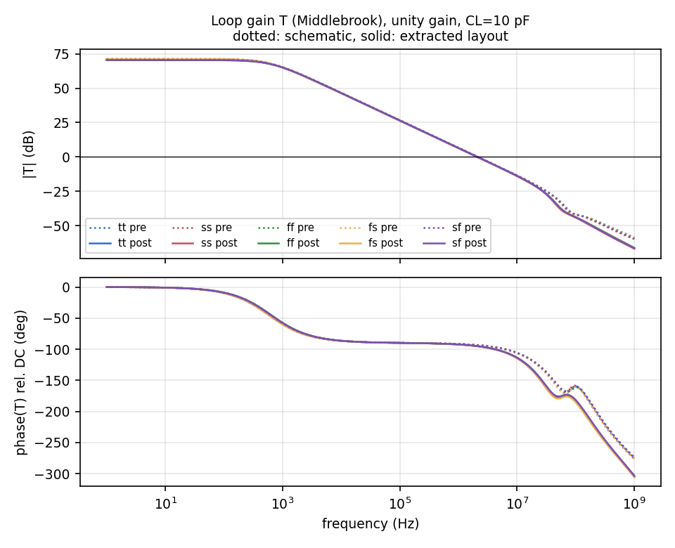
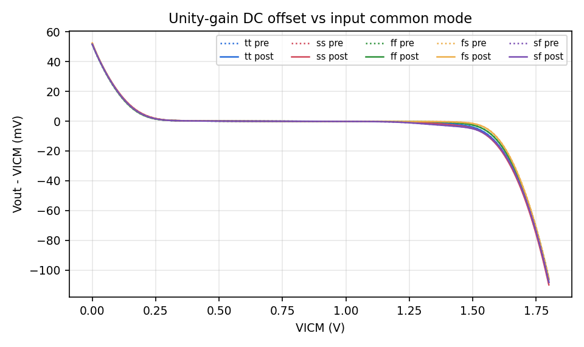
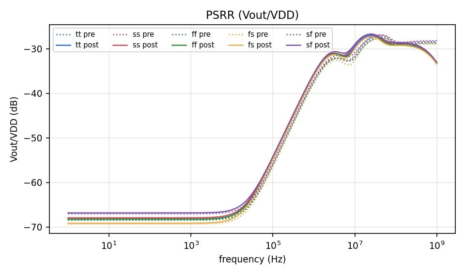
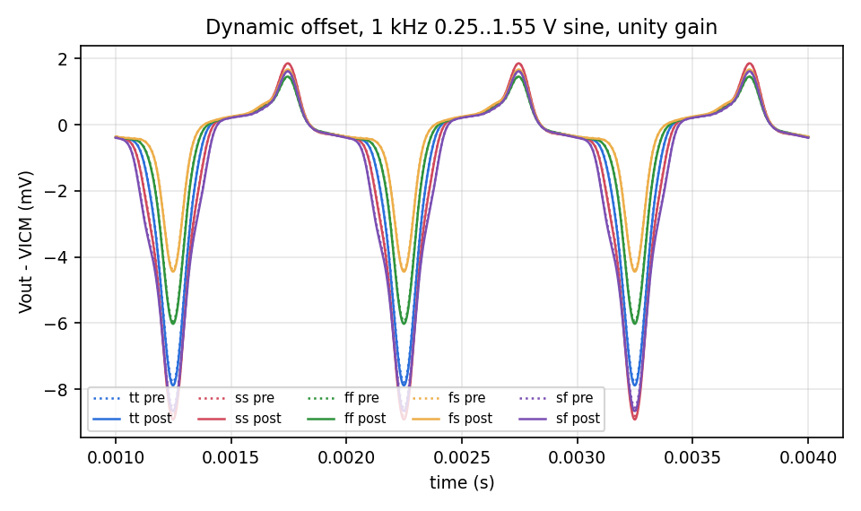
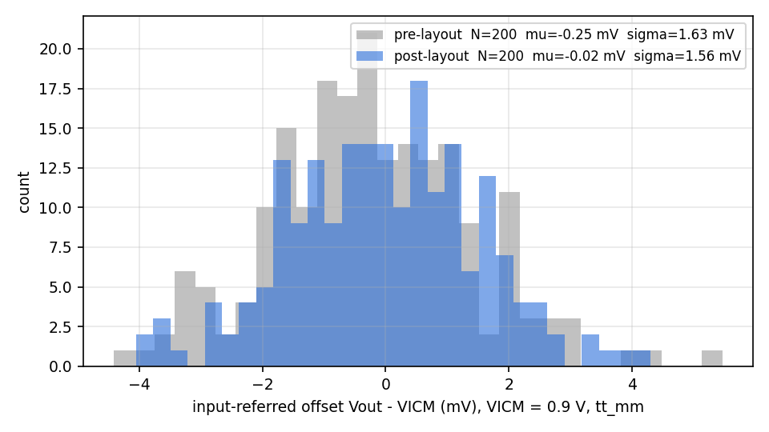
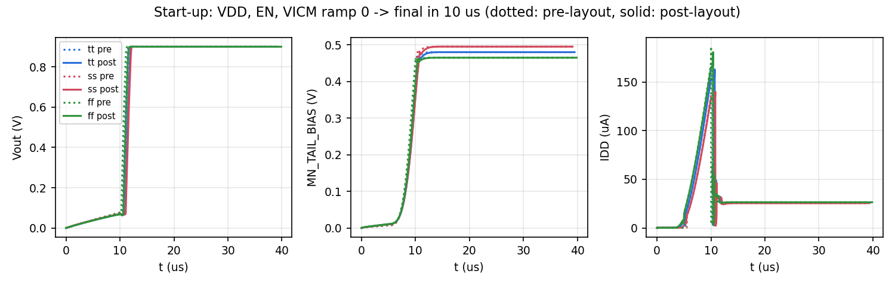

# Post-Layout Verification: `Rail_to_Rail_IP_OP_OTA_with_Intrenal_Bias` (SKY130A)

_Generated 2026-10-17 by `sim/make_report.py` from the signoff and simulation results in this directory. Every number below comes from those files._

Layout of the rail-to-rail-input folded-cascode OTA with internal beta-multiplier bias from `OTAs/RR_Inp_SE_OTA_IntBias`. **The schematic was not modified.**

## 1. Signoff summary

| Check | Tool / setup | Result |
|---|---|---|
| DRC | magic 8.3, `drc(full)`, sky130A tech | **0 errors** |
| DRC (2nd opinion) | KLayout `sky130A_mr.drc`, FEOL+BEOL+off-grid (256 rule categories) | **0 violations** |
| Antenna | magic `antennacheck` | **0 violations** |
| LVS | netgen 1.5 + `sky130A_setup.tcl`, layout vs xschem netlist of the untouched schematic | **Circuits match uniquely.** (64 merged devices, 44 nets, no property errors) |
| PEX | magic full RC (`extresist`, coupling C, cthresh=0, rthresh=0) | 225 device fingers, 1450 C, 1464 R |
| Post-layout simulation | ngspice, 5 corners + 200-run mismatch MC + start-up | all specs preserved, see §4 |

**Cell size:** 87.07 µm × 47.02 µm = 4094 µm².

_Full layout (KLayout render of the final GDS). Left: OTA core around a vertical symmetry axis. Right: internal bias (beta-multiplier XM1/XM10, xhigh-po resistors, start-up stack, enable logic)._

_Input pairs. Top: NMOS pair 2×8 (ABBAABBA / BAABBAAB) in a p-tap guard ring. Bottom: PMOS pair 4×14 (rows X, X̄, X̄, X with X = ABBAABBAABBAAB) in an n-tap guard ring. Gate contacts of MP_A1/MN_A1 (VINP) and MP_A2/MN_A2 (VINN) alternate sides and share li straps between rows._

## 2. What was compared

| | Pre-layout (schematic) | Post-layout (layout) |
|---|---|---|
| Netlist | `sim/dut_sch.spice`: xschem simulation netlist of the original `.sch` (device lines identical to the repo's `different_spice/…spice`, incl. `mult`, AD/AS from xschem) | `pex/Rail_to_Rail_IP_OP_OTA_with_Intrenal_Bias_rcx.spice`: magic RC extraction of the final layout |
| Devices | 80 instances with `m=` multipliers | 225 individual fingers with real AD/AS/PD/PS |
| Parasitics | none | 1450 capacitors (to substrate + coupling), 1464 wire/contact resistors |

Both DUTs are dropped into **identical testbench decks** (only the `.include` line differs). Models: `sky130A/libs.tech/combined/sky130.lib.spice`. Conditions: VDD = 1.8 V, EN = 1.8 V, T = 27 °C, CL = 10 pF on VOUT, 1 pF on MN_TAIL_BIAS (as in the original testbenches).

| Testbench | Configuration | Extracted metrics |
|---|---|---|
| STB | Unity-gain loop broken with a Middlebrook probe (two AC runs: V-probe and I-probe), VICM = 0.9 V, 1 Hz–1 GHz, 40 pts/dec | DC loop gain (at 1 Hz), UGF, phase margin |
| DC | Unity gain, VICM swept 0 → 1.8 V in 5 mV steps | offset at 0.9 V, worst offset over 0.2–1.6 V |
| PSRR | Unity gain, VICM = 0.9 V, 1 V AC on VDD | Vout/VDD at 10 Hz and 1 MHz |
| TRAN | Unity gain, 0.9 V ± 0.65 V, 1 kHz sine (0.25–1.55 V), 4 ms | peak abs(Vout − VICM) after 1 ms |
| OP | Unity gain, VICM = 0.9 V | IDD, V(MN_TAIL_BIAS) |
| Start-up | VDD, EN, VICM ramp 0 → final in 10 µs, 2 ms, Gear integration | settling of Vout, final IDD and bias |
| MC | `tt_mm` (mismatch on), unity gain, VICM = 0.9 V, 200 independent ngspice processes (`.options seed=1…200`) | offset mean, σ |

Corners: tt, ss, ff, fs, sf (same set as the IP README).

## 3. Headline comparison (tt, 27 °C)

| Parameter | Unit | Schematic | Layout (RC) | Δ (layout − sch) |
|---|---|---|---|---|
| DC loop gain | dB | 71.12 | 70.90 | -0.23 |
| Unity-gain frequency | MHz | 2.147 | 2.104 | -0.043 (-2.00 %) |
| Phase margin | deg | 86.64 | 84.98 | -1.66 |
| Systematic offset @ VICM=0.9 V | mV | -0.075 | -0.075 | -0.000 |
| Worst-case offset, VICM 0.2–1.6 V | mV | 15.64 | 15.80 | +0.16 |
| PSRR @ 10 Hz (Vout/VDD) | dB | -68.45 | -68.25 | +0.20 |
| PSRR @ 1 MHz (Vout/VDD) | dB | -37.36 | -35.90 | +1.46 |
| Peak dynamic offset (1 kHz sine) | mV | 7.788 | 7.887 | +0.098 |
| Supply current | uA | 26.013 | 25.970 | -0.043 (-0.16 %) |
| MN_TAIL_BIAS voltage | V | 0.4800 | 0.4800 | +0.0000 |
| MC offset σ (N=200/200) | mV | 1.625 | 1.562 | -0.063 |
| MC offset mean | mV | -0.253 | -0.018 | +0.235 |

_MC mean standard error ≈ 0.11 mV (σ/√N), so the two means agree to within about 2 standard errors; the systematic offset from the deterministic DC run is identical (−0.075 mV)._

## 4. Results across corners

**DC loop gain (dB)**

| | tt | ss | ff | fs | sf |
|---|---|---|---|---|---|
| schematic | 71.12 | 71.31 | 70.68 | 71.37 | 70.76 |
| layout | 70.90 | 71.10 | 70.43 | 71.15 | 70.53 |
| Δ | -0.23 | -0.21 | -0.25 | -0.22 | -0.23 |

**Unity-gain frequency (MHz)**

| | tt | ss | ff | fs | sf |
|---|---|---|---|---|---|
| schematic | 2.147 | 2.120 | 2.167 | 2.131 | 2.151 |
| layout | 2.104 | 2.078 | 2.123 | 2.089 | 2.108 |
| Δ | -0.043 (-2.00 %) | -0.042 (-1.98 %) | -0.044 (-2.03 %) | -0.042 (-1.99 %) | -0.043 (-2.01 %) |

**Phase margin (deg)**

| | tt | ss | ff | fs | sf |
|---|---|---|---|---|---|
| schematic | 86.64 | 86.62 | 86.67 | 86.63 | 86.66 |
| layout | 84.98 | 84.94 | 85.03 | 84.95 | 85.05 |
| Δ | -1.66 | -1.68 | -1.64 | -1.68 | -1.62 |

**Systematic offset @ VICM=0.9 V (mV)**

| | tt | ss | ff | fs | sf |
|---|---|---|---|---|---|
| schematic | -0.075 | -0.077 | -0.074 | -0.059 | -0.093 |
| layout | -0.075 | -0.078 | -0.074 | -0.059 | -0.094 |
| Δ | -0.000 | -0.000 | -0.000 | +0.000 | -0.001 |

**Worst-case offset, VICM 0.2–1.6 V (mV)**

| | tt | ss | ff | fs | sf |
|---|---|---|---|---|---|
| schematic | 15.64 | 16.85 | 13.51 | 11.65 | 16.18 |
| layout | 15.80 | 17.03 | 13.65 | 11.78 | 16.34 |
| Δ | +0.16 | +0.18 | +0.14 | +0.13 | +0.17 |

**PSRR @ 10 Hz (Vout/VDD) (dB)**

| | tt | ss | ff | fs | sf |
|---|---|---|---|---|---|
| schematic | -68.45 | -68.11 | -68.47 | -69.34 | -67.03 |
| layout | -68.25 | -67.93 | -68.25 | -69.14 | -66.83 |
| Δ | +0.20 | +0.18 | +0.22 | +0.20 | +0.20 |

**PSRR @ 1 MHz (Vout/VDD) (dB)**

| | tt | ss | ff | fs | sf |
|---|---|---|---|---|---|
| schematic | -37.36 | -37.08 | -37.60 | -37.66 | -36.95 |
| layout | -35.90 | -35.65 | -36.12 | -36.13 | -35.57 |
| Δ | +1.46 | +1.43 | +1.48 | +1.53 | +1.38 |

**Peak dynamic offset (1 kHz sine) (mV)**

| | tt | ss | ff | fs | sf |
|---|---|---|---|---|---|
| schematic | 7.788 | 8.805 | 5.944 | 4.383 | 8.554 |
| layout | 7.887 | 8.917 | 6.023 | 4.446 | 8.662 |
| Δ | +0.098 | +0.112 | +0.079 | +0.063 | +0.107 |

**Supply current (uA)**

| | tt | ss | ff | fs | sf |
|---|---|---|---|---|---|
| schematic | 26.013 | 25.526 | 26.493 | 25.894 | 26.131 |
| layout | 25.970 | 25.485 | 26.449 | 25.852 | 26.087 |
| Δ | -0.043 (-0.16 %) | -0.041 (-0.16 %) | -0.044 (-0.17 %) | -0.041 (-0.16 %) | -0.044 (-0.17 %) |

**MN_TAIL_BIAS voltage (V)**

| | tt | ss | ff | fs | sf |
|---|---|---|---|---|---|
| schematic | 0.4800 | 0.4950 | 0.4649 | 0.5069 | 0.4531 |
| layout | 0.4800 | 0.4951 | 0.4650 | 0.5070 | 0.4531 |
| Δ | +0.0000 | +0.0000 | +0.0001 | +0.0000 | +0.0000 |

### 4.1 Loop gain / stability

### 4.2 DC transfer: offset vs input common mode

### 4.3 PSRR

### 4.4 Transient tracking (dynamic offset)

### 4.5 Monte Carlo offset (mismatch, tt_mm)

| | N | mean (mV) | σ (mV) | ±3σ (mV) | min (mV) | max (mV) |
|---|---|---|---|---|---|---|
| schematic | 200 | -0.253 | 1.625 | ±4.88 | -4.41 | 5.47 |
| layout | 200 | -0.018 | 1.562 | ±4.69 | -4.06 | 4.30 |

With N = 200 the 95 % confidence interval on σ is about ±10 %, so the two σ values are statistically the same. The IP README reports σ = 1.59 mV (N = 1000), which agrees.

### 4.6 Start-up

| corner | view | Vout final (V) | MN_TAIL_BIAS final (V) | IDD final, 1.8–2 ms avg (µA) | Vout within 1 mV after (µs) |
|---|---|---|---|---|---|
| tt | schematic | 0.8999 | 0.4800 | 26.01 | 11.7 |
| tt | layout | 0.8999 | 0.4800 | 25.97 | 12.2 |
| ss | schematic | 0.8999 | 0.4951 | 25.53 | 11.8 |
| ss | layout | 0.8999 | 0.4951 | 25.48 | 12.3 |
| ff | schematic | 0.8999 | 0.4649 | 26.49 | 11.4 |
| ff | layout | 0.8999 | 0.4650 | 26.45 | 11.8 |

The supply ramps for 10 µs. In every corner the internal bias starts, Vout settles to within 1 mV about 2 µs after the ramp ends, and the final supply current equals the DC operating point.

**Start-up mechanism, probed in the extracted layout (tt, nets carry schematic names via layout labels):**

| t (µs) | VDD | VSTRP_IP | net14 | VSTRP_OUT | EN_B | VBP_TOP | MN_TAIL_BIAS | VOUT |
|---|---|---|---|---|---|---|---|---|
| 2 | 0.361 | 0.175 | 0.162 | 0.251 | 0.069 | 0.135 | 0.005 | 0.016 |
| 4 | 0.721 | 0.360 | 0.599 | 0.694 | 0.000 | 0.271 | 0.008 | 0.031 |
| 6 | 1.080 | 0.128 | 1.079 | 0.181 | 0.001 | 0.403 | 0.013 | 0.045 |
| 8 | 1.440 | 0.099 | 1.438 | 0.291 | 0.003 | 0.600 | 0.082 | 0.058 |
| 10 | 1.800 | 0.058 | 1.795 | 0.421 | 0.005 | 1.013 | 0.361 | 0.068 |
| 12 | 1.800 | 1.786 | 0.000 | 1.800 | 0.000 | 0.705 | 0.476 | 0.894 |
| 15 | 1.800 | 1.786 | 0.000 | 1.800 | 0.000 | 0.701 | 0.480 | 0.900 |
| 20 | 1.800 | 1.786 | 0.000 | 1.800 | 0.000 | 0.701 | 0.480 | 0.900 |
| 40 | 1.800 | 1.786 | 0.000 | 1.800 | 0.000 | 0.701 | 0.480 | 0.900 |

While the bias is still off, VSTRP_IP is low and net14 high. VSTRP_OUT is pulled to 0.2–0.4 V, which turns M12 on and injects current from the R24–R34 chain into MN_TAIL_BIAS. Once the beta multiplier is up (~12 µs), M2 lifts VSTRP_IP to 1.79 V, net14 falls, VSTRP_OUT returns to 1.8 V and the injector switches off. Design observation (schematic left unchanged): with EN = 1, M14 (gate EN_B = 0) is always on, so VSTRP_OUT is a ratioed node during start-up (M38/M39 overpower M14). It works in all simulated corners, both pre- and post-layout.

## 5. Parasitics of the critical nets

Total extracted capacitance per net, summing caps to substrate and coupling to all other nets. Internal nets carry the schematic names via layout labels.

| Net | Role | C_total (fF) | extracted R segments |
|---|---|---|---|
| VINP | input + | 66.67 | 69 |
| VINN | input − | 67.25 | 71 |
| net1 | PMOS-pair drain A / NMOS fold | 51.35 | 73 |
| net2 | PMOS-pair drain B / NMOS fold | 54.09 | 73 |
| net3 | NMOS-pair drain A / PMOS fold | 19.35 | 43 |
| net4 | NMOS-pair drain B / PMOS fold | 17.84 | 42 |
| net5 | high-Z node L1 (mirror gate) | 30.41 | 47 |
| VOUT | output | 16.74 | 21 |
| net6 | NMOS-pair tail | 24.13 | 47 |
| net7 | PMOS-pair tail | 66.81 | 127 |
| MN_TAIL_BIAS | bias node / pin | 68.98 | 55 |
| EN | enable | 12.99 | 13 |

**Symmetry of matched nets**

| Pair | C (fF) | C (fF) | mismatch |
|---|---|---|---|
| VINP / VINN | 66.67 | 67.25 | +0.9 % |
| net1 / net2 | 51.35 | 54.09 | +5.2 % |
| net3 / net4 | 19.35 | 17.84 | -8.1 % |

The input nets match to under 1 %. The folding nodes differ by 1.5–2.7 fF because the net1/net3 buses run on the left of the core and net2/net4 on the right with different lengths. These are non-dominant, low-impedance nodes (1/gm of the cascodes), so the imbalance does not show up in the offset (the systematic offset is unchanged to 1 µV, §3).

## 6. Discussion

* **Stability / bandwidth.** UGF drops by -2.0 % and phase margin by 1.66°, the same in every corner. This is the expected effect of the extracted wiring and junction capacitance at the folding nodes (net1–net5) on the non-dominant poles. With the 10 pF load the OTA stays over-damped (PM ≈ 85°).
* **DC accuracy.** Systematic offset is unchanged (≤ 1 µV difference). The DC loop gain changes by -0.23 dB. IR drops in the routing are negligible at this 26 µA supply current, consistent with VOUT and MN_TAIL_BIAS matching to 0.1 mV.
* **PSRR.** Low-frequency PSRR is unchanged within 0.2 dB. At 1 MHz it degrades by 1.5 dB through extracted coupling capacitance from the VDD rails/ring to internal nodes; it remains ≈ -36 dB.
* **Matching.** Mismatch σ is preserved (layout and schematic are statistically identical). SPICE Monte Carlo models only random mismatch. The common-centroid placement (§7) additionally cancels linear process gradients, which neither simulation captures; this is a layout-only benefit.
* **Power and start-up.** IDD differs by < 0.2 %. Start-up is clean in ss/tt/ff and identical to the schematic within 0.4 µs.

## 7. Matching / floorplan decisions

| Group | Arrangement |
|---|---|
| MP_A1/MP_A2 (pfet_lvt, 28+28 × W4/L2) | 4×14, rows X X̄ X̄ X (X = ABBAABBAABBAAB): common centroid in x and y and cancels the xy cross-term; edge fingers balanced (A at the ends of rows 1/4, B of rows 2/3); n-tap guard ring |
| MN_A1/MN_A2 (nfet_lvt, 8+8 × W2.5/L2) | 2×8 ABBAABBA / BAABBAAB, 2-D common centroid; p-tap guard ring |
| MP_TOP_L1/L2 (6+6) | ABBA·ABBA·ABBA, continuous diffusion |
| MN_BOT_L1/L2 (6+6), MN_NDIFF_BIAS (8) | 2 rows ABBAAB / BAABBA (2-D CC), NDIFF_BIAS split symmetrically 2+2 per row |
| MP_CASC_L1/L2 (8+8) | [A4][B4][B4][A4] |
| MN_CASC_L1/L2 (3+3) | [A1][B2][A2][B1] (closest to centroid possible with 3+3) |
| net9 mirror | MP_PDIFF_BIAS 4 + 4 symmetric about the diode MP_PDIFF_BIAS_B |
| VBP_TOP mirror | M3 (diode) and M4 adjacent with shared source; M9, M2 same row and orientation |
| XM1/XM10 (16+4 × W10/L4) | 2 identical rows [M1×4][M10×2][M1×4]: 2-D common centroid, merged gate strap |

Per-finger W and L are the schematic's, and netgen merges parallel fingers, so sizes match exactly. Dummy transistors were **not** added: they would appear as extra devices in LVS against the unmodified schematic. Edge effects are handled by the common-centroid patterns instead.

## 8. Notes for integration

* LVS reference: the schematic ties NMOS bodies to the global `GND` net. In silicon the p-substrate is `GNDA` (all p-taps), so `lvs/run_lvs.sh` maps body `GND` → `GNDA`. Nothing else is altered.
* Pins (port order = symbol order): VDD (met1, top rail), EN (met2, right edge), VINN (met3, top), VOUT (met3, bottom), VINP (met3, left), MN_TAIL_BIAS (met3, bottom), GNDA (met1, bottom rail). met4/met5 are unused and free for top-level routing.
* Reproduce everything with `./run_all.sh` (layout generation → magic DRC → KLayout DRC → LVS → PEX → all simulations). Then `python3 sim/plot_results.py && python3 sim/parasitics.py && python3 sim/make_report.py`.
* Simulation note: the start-up supply current must be read with Gear integration (or averaged). Trapezoidal integration rings point-to-point on the source current; the ringing averages to the DC value.
