# Rail-to-Rail Input OTA IP — SKY130 PDK

> **Author:** Nithin Purushothama  
> **PDK:** SkyWater SKY130 (sky130A)  
> **Toolchain:** Xschem · Ngspice · Magic VLSI · Netgen  
> **Last Updated:** 2026-08-15
> **Area:** 47.15µmx47.15µm
> **Layout:** 87.07 µm × 47.20 µm (4109 µm²), DRC/LVS clean, post-layout verified → [`LAYOUT/`](LAYOUT/README.md)

---

## Table of Contents

1. [Overview](#overview)
2. [Architecture](#architecture)
3. [Design Methodology](#design-methodology)
4. [Schematic](#schematic)
5. [Simulation Results](#simulation-results)
   - [DC Transfer Characteristics](#1-dc-transfer-characteristics)
   - [Stability (Loop Gain & Phase)](#2-stability-loop-gain--phase)
   - [Transient Response](#3-transient-response)
   - [PSRR](#4-psrr)
   - [Monte Carlo — Input-Referred Offset](#5-monte-carlo--input-referred-offset)
6. [Performance Summary](#performance-summary)
7. [Layout & Post-Layout Verification](#layout--post-layout-verification)
   - [Signoff (DRC / LVS / antenna / PEX)](#1-signoff-summary)
   - [Schematic vs layout: headline comparison](#3-headline-comparison-tt-27-c)
   - [Results across corners, PEX-only plots, MC, start-up](#4-results-across-corners)
   - [Power-down & enable timing](#48-power-down-en--0-and-enable--disable-timing)
   - [Layout vs PEX: where the deltas come from](#5-layout-vs-pex-where-the-deltas-come-from)
   - [Parasitics of the critical nets](#6-parasitics-of-the-critical-nets)
8. [File Structure](#file-structure)

---

## Overview

This IP implements a **rail-to-rail input swing OTA** in the SkyWater 130 nm SKY130 PDK. The design achieves full input common-mode range (0 V to V<sub>DD</sub>) by employing complementary PMOS and NMOS differential input pairs, both folded into a shared cascode output stage. The OTA is designed for 1.8 V supply with simulations across all five process corners (tt, ss, ff, fs, sf) and Monte Carlo mismatch analysis.

---

## Architecture

The OTA is built on a **folded-cascode topology** with the following key architectural choices:

- **Complementary input pairs:** A PMOS differential pair (active near V<sub>DD</sub>) and an NMOS differential pair (active near GND) are operated in parallel. This combination ensures that at least one pair remains in saturation for any input common-mode voltage between 0 V and V<sub>DD</sub>, yielding true rail-to-rail input swing.
- **Folded cascode output stage:** Both input pair drain currents are folded and summed at a shared cascode output node, providing high output impedance and consequently high DC gain without a second gain stage.
- **Enable/disable switches (EN / EN_B):** Dedicated PMOS (MP_SW1, MP_SW3) and NMOS (MN_SW1, MN_SW2) switches allow the bias network and input pairs to be independently enabled, enabling power gating.
- **Separate PMOS and NMOS bias trees:** Cascoded bias mirrors (VBP_CASC, VBN_CASC) generated from a 1 µA reference set the quiescent operating point of all branches. The PMOS diff-pair bias (~8 µA total) and NMOS diff-pair bias (~8 µA total) are sized for symmetric g<sub>m</sub> contribution across the input range.
- **LVT input transistors:** The differential pair devices use `pfet_01v8_lvt` and `nfet_01v8_lvt` to maximise g<sub>m</sub>/I<sub>D</sub> and extend input range toward the rails.

---

## Design Methodology

Transistor sizing was performed using the **g<sub>m</sub>/I<sub>D</sub> design methodology**:

- PMOS diff pair: g<sub>m</sub>/I<sub>D</sub> = 19, I<sub>D</sub>/W = 0.037 µA/µm → sized at 28 × 4/2 (fingers × W/L)
- NMOS diff pair: g<sub>m</sub>/I<sub>D</sub> = 20, I<sub>D</sub>/W = 0.22 µA/µm → sized at 8 × 2.5/2
- Cascode bias source (PMOS): g<sub>m</sub>/I<sub>D</sub> = 10, V<sub>dsat</sub> = 200 mV → sized at 1 × 2/2
- Cascode bias source (NMOS): g<sub>m</sub>/I<sub>D</sub> = 10, V<sub>dsat</sub> = 200 mV, I<sub>D</sub>/W = 2.3 µA/µm → sized at 1 × 0.5/2

The folded cascode topology was chosen over a two-stage Miller-compensated OTA to avoid the need for a compensation capacitor while maintaining a clean single-pole dominant response up to the UGF.

---

## Schematic


> Full schematic: `SCH/Rail_to_Rail_IP_OP_OTA_with_Intrenal_Bias.sch` (Xschem)

Key nodes and current budgets annotated on schematic:

| Branch | Quiescent Current |
|---|---|
| PMOS cascode bias tree | ~1 µA |
| NMOS cascode bias tree | ~1 µA |
| PMOS diff pair (each side) | ~8 µA |
| NMOS diff pair (each side) | ~8 µA |
| Output cascode (L1 + L2) | ~2 µA + 4 µA per side |

---
## Area Estimate: 
47.15µmx47.15µm (This is Schematic based approximation and not based on real layout)

> **Actual layout (see [Layout & Post-Layout Verification](#layout--post-layout-verification)):** 87.07 µm × 47.20 µm = **4109 µm²**, DRC/LVS clean. The estimator's device subtotal matched the drawn devices closely (1710 µm² estimated vs 1734 µm² of gate + resistor body). The real routing / well / guard-ring overhead is ≈ ×2.4 rather than the ×1.3 assumed, because of the guard rings and taps around the matched pairs, well spacing, shared-diffusion S/D strips and the met3 bus margins.

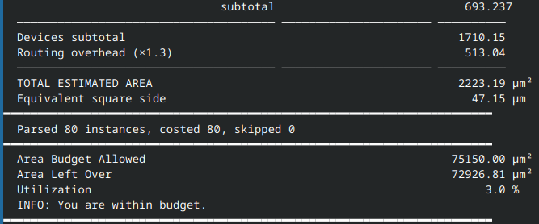

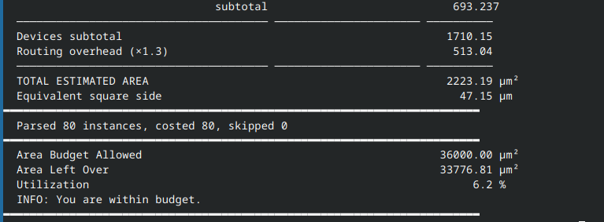


---

## Simulation Results

All simulations were run across **5 PVT corners** (tt, ss, ff, fs, sf) at T = 27°C, V<sub>DD</sub> = 1.8 V unless noted. Monte Carlo used N = 200 runs with SKY130 mismatch models.

---

### 1. DC Transfer Characteristics

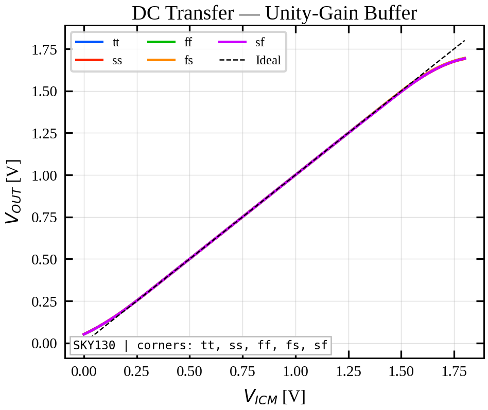

**What is shown:**
- **(Top)** V<sub>out</sub> vs. V<sub>ICM</sub> (unity-gain configuration) sweeping the input common-mode from 0 V to 1.8 V across all corners. The output closely tracks the ideal y = x line across the full swing.
- **(Bottom)** Offset voltage (V<sub>out</sub> − V<sub>ICM</sub>) vs. V<sub>ICM</sub>. The flat near-zero region (0.2 V – 1.5 V) confirms proper rail-to-rail operation. The roll-off near GND and V<sub>DD</sub> is a consequence of the differential pair transitions at the rails.

**Key observations:**
- Offset remains below ±5 mV across 0.2 V – 1.5 V of input common-mode range in TT corner.
- Corner spread is minimal in the linear region, with all five corners tightly overlapping.
- Near-rail offsets (>50 mV) are expected and occur only in the last ~200 mV at each rail where one input pair leaves saturation.

---

### 2. Stability (Loop Gain & Phase)

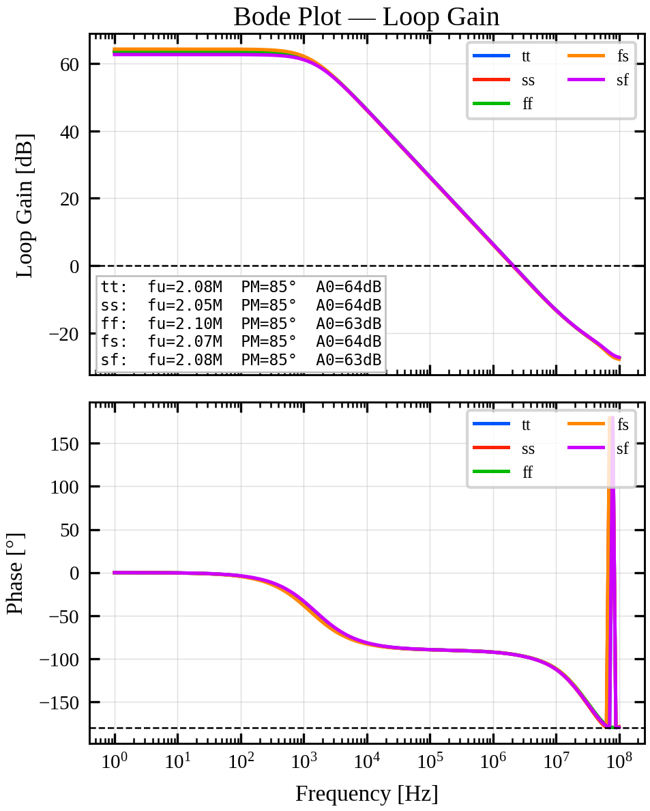

Stability analysis performed using the **Middlebrook two-port method** in Ngspice, with the OTA configured in unity-gain feedback and a 10 pF load.

**Results across corners:**

| Corner | UGF | Phase Margin | DC Gain (A₀) |
|:---:|:---:|:---:|:---:|
| tt | 2.08 MHz | 85.2° | 63.7 dB |
| ss | 2.06 MHz | 85.1° | 63.5 dB |
| ff | 2.11 MHz | 85.2° | 63.5 dB |
| fs | 2.07 MHz | 85.2° | 64.3 dB |
| sf | 2.09 MHz | 85.1° | 62.7 dB |

**Key observations:**
- Phase margin of **~85.1°** is consistent across all corners — an extremely stable design with significant margin above the 45° minimum.
- UGF varies only from 2.06 MHz to 2.11 MHz, demonstrating tight corner tracking (~2% spread).
- DC gain ranges from 62.7–64.3 dB, consistent with a single folded-cascode stage.
- The dominant pole is clearly visible at ~1 kHz; no secondary poles appear before UGF.

---

### 3. Transient Response

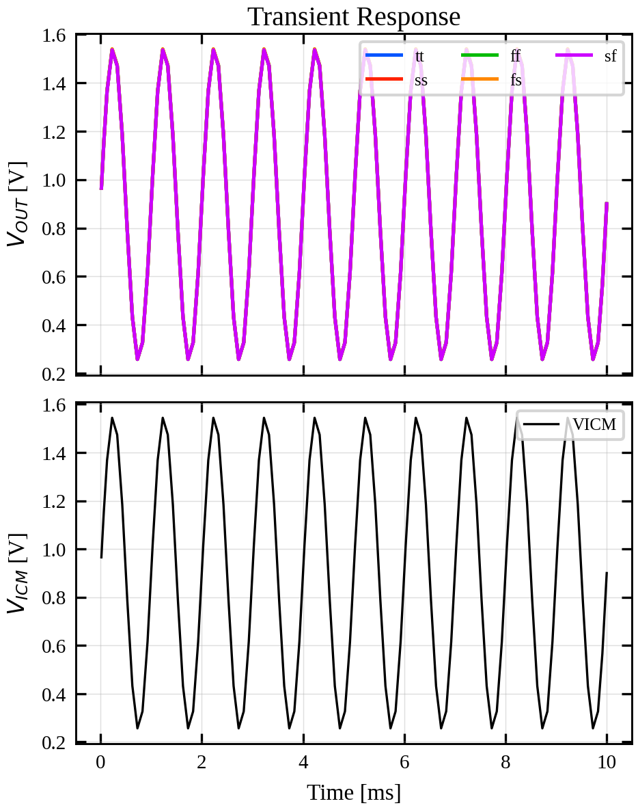

**Test setup:** Unity-gain configuration with a sinusoidal V<sub>ICM</sub> input sweeping 0.25 V – 1.55 V (covering ~75% of the rail-to-rail range dynamically).

**What is shown:**
- **(Top)** V<sub>out</sub> (solid) tracking V<sub>ICM</sub> (dotted) over 10 ms, across all corners. Near-perfect sinusoidal tracking with no visible distortion or clipping.
- **(Bottom)** Dynamic offset (V<sub>out</sub> − V<sub>ICM</sub>) vs. time in mV. The transient offset spikes at the peaks/troughs of the sine wave correspond to the momentary gain reduction as the input common-mode traverses the differential pair transition region.

**Key observations:**
- Peak transient offset magnitude stays below ~7 mV at the extremes of swing.
- Steady-state dynamic offset in the mid-swing region is sub-mV, consistent with DC analysis.
- Corner spread in transient offset is small, with the sf/ff corners showing marginally higher peaks.

---

### 4. PSRR

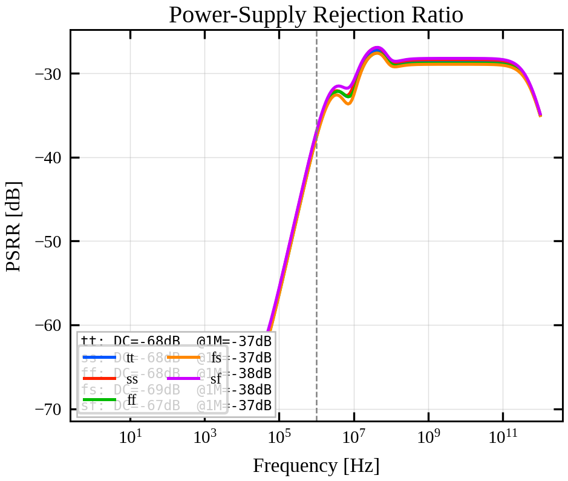

Power Supply Rejection Ratio measured as V<sub>out</sub>/V<sub>DD</sub> in dB vs. frequency.

**Key observations:**
- DC PSRR is approximately **−67 to −69 dB** across all corners — good supply rejection at low frequency owing to the high-impedance cascoded bias network.
- PSRR degrades above ~100 kHz, settling to approximately **−37 dB** at 1 MHz (marked by the vertical dashed line) and beyond.
- The degradation above the dominant pole frequency is expected in a single-stage OTA; PSRR tracks the open-loop gain rolloff.
- All five corners overlap tightly, indicating PSRR is not process-sensitive.

---

### 5. Monte Carlo — Input-Referred Offset

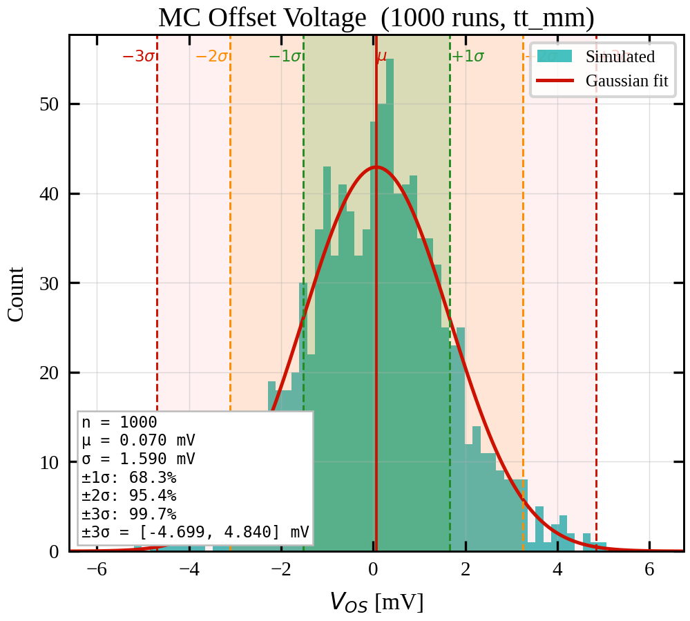

Monte Carlo mismatch simulation with **N = 1000 runs** using SKY130 statistical mismatch models.

**Results:**

| Parameter | Value |
|---|---|
| Number of runs (N) | 1000 |
| Mean offset (μ) | 0.07 mV |
| Std. deviation (σ) | 1.59 mV |
| Variance (σ²) | 2.53 mV² |
| ±3σ range | ±4.77 mV |

**Key observations:**
- The offset distribution is well-centered at μ = 0.07 mV, confirming good layout symmetry in the input differential pair.
- σ = 1.59 mV is competitive for an untrimmed OTA in a 130 nm process.
- The ±3σ window spans approximately ±4.77 mV, meaning >99.7% of fabricated instances will have offset below 5 mV.
- The histogram shape is approximately Gaussian, consistent with uncorrelated mismatch contributions from the diff pair and load devices.

---

## Performance Summary

| Parameter | Value | Conditions |
|---|---|---|
| Supply Voltage | 1.8 V | Nominal |
| Input Common-Mode Range | 0 – 1.8 V | Rail-to-Rail |
| DC Gain (A₀) | 62.7 – 64.3 dB | All corners |
| Unity Gain Frequency | 2.06 – 2.11 MHz | All corners, C<sub>L</sub> = 10 pF |
| Phase Margin | ~85.1° | All corners |
| DC PSRR | ~−68 dB | Low frequency |
| PSRR @ 1 MHz | ~−37 dB | All corners |
| Input-Referred Offset (μ) | 0.07 mV | MC, N=1000 |
| Input-Referred Offset (σ) | 1.59 mV | MC, N=1000 |
| Topology | Folded Cascode | Complementary input pairs |
| PDK | SKY130 (sky130A) | SkyWater 130 nm |
| Input Device Type | LVT (pfet/nfet_01v8_lvt) | — |
| Power-down current (EN = 0) | 16.6 pA (tt, 27 °C); 11–29 pA all corners; 2.4 nA @ 125 °C | Post-layout (PEX), see [Layout](#layout--post-layout-verification) |
| Wake-up time (EN↑ → Vout within 1 mV) | 4.2 µs (tt); 3.8–4.7 µs ss/ff | Post-layout (PEX) |
| Layout area | 87.07 µm × 47.20 µm = 4109 µm² | DRC/LVS clean, see [`LAYOUT/`](LAYOUT/README.md) |

---

## Layout & Post-Layout Verification

<!-- BEGIN:LAYOUT-VERIFICATION -->
A full custom layout of this OTA, with physical verification and post-layout verification, is in [`LAYOUT/`](LAYOUT/README.md). **The schematic in `SCH/` was not modified.** Everything below is generated by `LAYOUT/sim/make_report.py` from the signoff and simulation results; file paths are relative to `LAYOUT/`. A standalone copy is in [`LAYOUT/docs/POST_LAYOUT_VERIFICATION.md`](LAYOUT/docs/POST_LAYOUT_VERIFICATION.md).

*Note:* this section uses one simulation harness for both the schematic and the extracted layout, so the two are directly comparable. Absolute values can differ slightly from the Performance Summary above, which came from the original scripts with different measurement definitions (for example, the DC loop gain here is |T| at 1 Hz from the Middlebrook loop gain).

**Plot folders:** schematic vs PEX → [`LAYOUT/sim/plots/`](LAYOUT/sim/plots/) · PEX only → [`LAYOUT/sim/plots/pex/`](LAYOUT/sim/plots/pex/) · layout vs PEX (four views) → [`LAYOUT/sim/plots/views/`](LAYOUT/sim/plots/views/) · power-down → [`LAYOUT/sim/plots/powerdown/`](LAYOUT/sim/plots/powerdown/)

### 1. Signoff summary

| Check | Tool / setup | Result |
|---|---|---|
| DRC | magic 8.3, `drc(full)`, sky130A tech | **0 errors** |
| DRC (2nd opinion) | KLayout `sky130A_mr.drc`, FEOL+BEOL+off-grid (256 rule categories) | **0 violations** |
| Antenna | magic `antennacheck` | **0 violations** |
| LVS | netgen 1.5 + `sky130A_setup.tcl`, layout vs xschem netlist of the untouched schematic | **Circuits match uniquely.** (64 merged devices, 44 nets, no property errors) |
| PEX, C-only | magic standard extraction: substrate + coupling C (cthresh=0) | 424 C, total 0.68 pF: **best estimate** of wiring capacitance |
| PEX, full RC | magic `extresist` (wire R + C, rthresh=0) | 225 device fingers, 1505 C, 1562 R, total 1.43 pF: **conservative** (see §5) |
| Post-layout simulation | ngspice, 5 corners + 200-run mismatch MC + start-up + power-down/enable | all specs preserved, see §4 |

**Cell size:** 87.07 µm × 47.20 µm = 4109 µm².

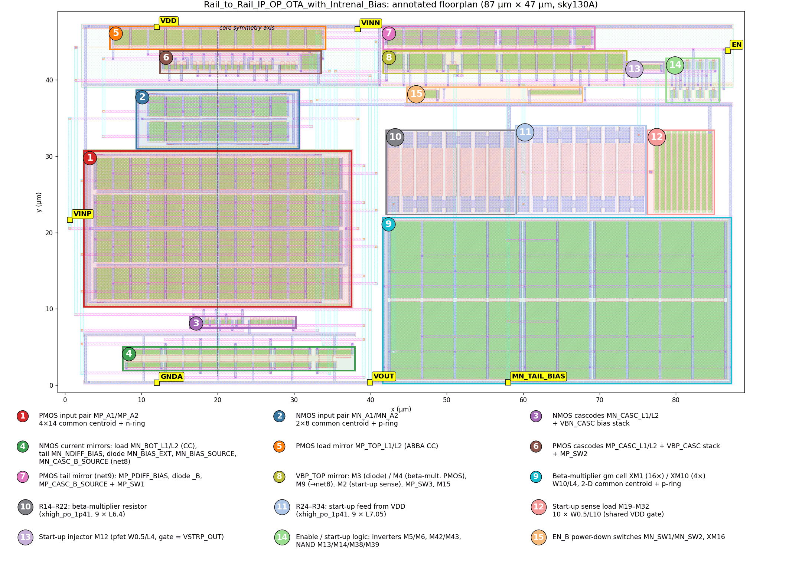

_Annotated floorplan: every functional block of the final layout outlined and numbered (input pairs, cascodes, current mirrors, beta-multiplier gm bias cell, resistors, start-up, enable logic) with the pin locations. Boxes come from the layout generator's own geometry._

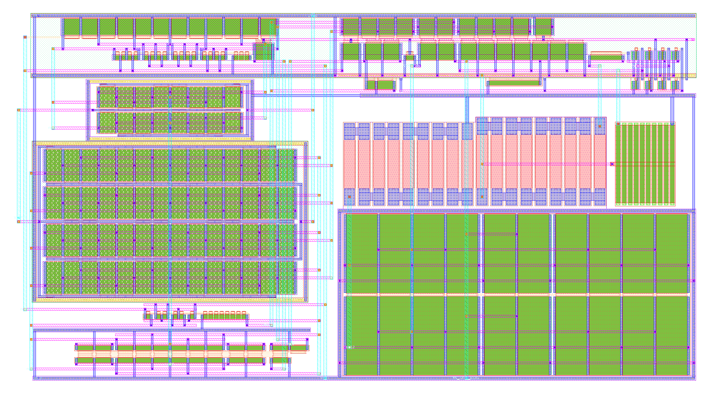

_Full layout (KLayout render of the final GDS). Left: OTA core around a vertical symmetry axis. Right: internal bias (beta-multiplier XM1/XM10, xhigh-po resistors, start-up stack, enable logic)._

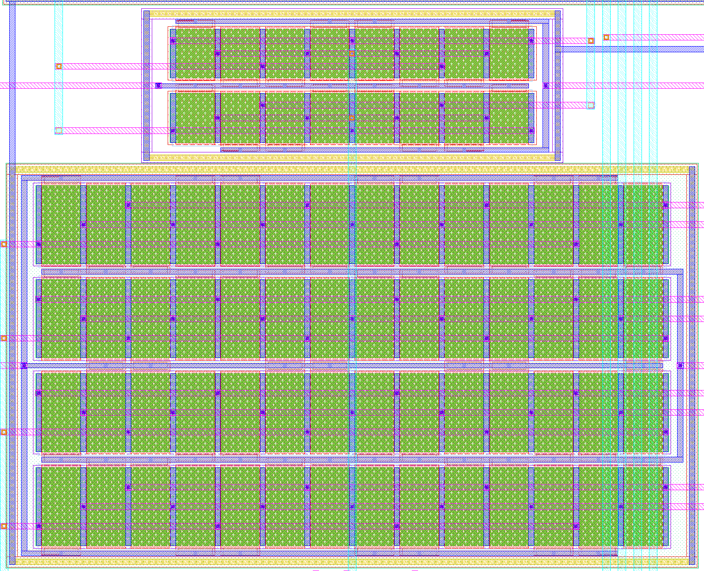

_Input pairs. Top: NMOS pair 2×8 (ABBAABBA / BAABBAAB) in a p-tap guard ring. Bottom: PMOS pair 4×14 (rows X, X̄, X̄, X with X = ABBAABBAABBAAB) in an n-tap guard ring. Gate contacts of MP_A1/MN_A1 (VINP) and MP_A2/MN_A2 (VINN) alternate sides and share li straps between rows._

### 2. What was compared

| | Pre-layout (schematic) | Post-layout (extracted layout) |
|---|---|---|
| Netlist | `sim/dut_sch.spice`: xschem simulation netlist of the original `.sch` (device lines identical to the repo's `different_spice/…spice`, incl. `mult`, AD/AS from xschem) | `pex/Rail_to_Rail_IP_OP_OTA_with_Intrenal_Bias_cx.spice` (**PEX C-only**, best estimate) and `pex/Rail_to_Rail_IP_OP_OTA_with_Intrenal_Bias_rcx.spice` (**PEX full RC**, conservative) |
| Devices | 80 instances with `m=` multipliers | 225 individual fingers with real AD/AS/PD/PS |
| Parasitics | none | C-only: 424 capacitors, 0.68 pF total. Full RC: 1505 capacitors (1.43 pF) + 1562 wire/contact resistors |

Both DUTs are dropped into **identical testbench decks** (only the `.include` line differs). Models: `sky130A/libs.tech/combined/sky130.lib.spice`. Conditions: VDD = 1.8 V, EN = 1.8 V, T = 27 °C, CL = 10 pF on VOUT, 1 pF on MN_TAIL_BIAS (as in the original testbenches).

| Testbench | Configuration | Extracted metrics |
|---|---|---|
| STB | Unity-gain loop broken with a Middlebrook probe (two AC runs: V-probe and I-probe), VICM = 0.9 V, 1 Hz–1 GHz, 40 pts/dec | DC loop gain (at 1 Hz), UGF, phase margin |
| DC | Unity gain, VICM swept 0 → 1.8 V in 5 mV steps | offset at 0.9 V, worst offset over 0.2–1.6 V |
| PSRR | Unity gain, VICM = 0.9 V, 1 V AC on VDD | Vout/VDD at 10 Hz and 1 MHz |
| TRAN | Unity gain, 0.9 V ± 0.65 V, 1 kHz sine (0.25–1.55 V), 4 ms | peak abs(Vout − VICM) after 1 ms |
| OP | Unity gain, VICM = 0.9 V | IDD, V(MN_TAIL_BIAS) |
| Start-up | VDD, EN, VICM ramp 0 → final in 10 µs, 2 ms, Gear integration | settling of Vout, final IDD and bias |
| MC | `tt_mm` (mismatch on), unity gain, VICM = 0.9 V, 200 independent ngspice processes (`.options seed=1…200`) | offset mean, σ |

Corners: tt, ss, ff, fs, sf (same set as the IP README).

### 3. Headline comparison (tt, 27 °C)

Two post-layout netlists are reported. **PEX C-only** is magic's standard parasitic extraction (substrate + coupling capacitance): the best estimate. **PEX full RC** is magic's `extresist` netlist. It adds wire resistance, but it also writes extra substrate capacitance on every resistor sub-node (1.43 pF total vs 0.68 pF), so it is a conservative bound. Wiring resistance itself is negligible (§5). Startup, power-down and MC were run on the conservative RC netlist.

| Parameter | Unit | Schematic | PEX C-only | PEX full RC | Δ C-only | Δ full RC |
|---|---|---|---|---|---|---|
| DC loop gain | dB | 71.12 | 70.95 | 70.90 | -0.17 | -0.23 |
| Unity-gain frequency | MHz | 2.147 | 2.121 | 2.099 | -0.026 (-1.20 %) | -0.048 (-2.22 %) |
| Phase margin | deg | 86.64 | 85.83 | 85.07 | -0.81 | -1.57 |
| Systematic offset @ VICM=0.9 V | mV | -0.075 | -0.076 | -0.075 | -0.001 | -0.000 |
| Worst-case offset, VICM 0.2–1.6 V | mV | 15.64 | 15.39 | 15.80 | -0.25 | +0.16 |
| PSRR @ 10 Hz (Vout/VDD) | dB | -68.45 | -68.29 | -68.25 | +0.16 | +0.20 |
| PSRR @ 1 MHz (Vout/VDD) | dB | -37.36 | -36.40 | -35.87 | +0.96 | +1.49 |
| Peak dynamic offset (1 kHz sine) | mV | 7.788 | 7.685 | 7.887 | -0.104 | +0.098 |
| Supply current | uA | 26.013 | 26.002 | 25.970 | -0.011 (-0.04 %) | -0.043 (-0.16 %) |
| MN_TAIL_BIAS voltage | V | 0.4800 | 0.4800 | 0.4800 | -0.0000 | +0.0000 |
| Power-down current (EN = 0) | pA | 15.8 | — | 16.6 | — | +0.9 |
| Wake-up time (EN↑ → Vout within 1 mV) | µs | 3.33 | — | 4.15 | — | +0.82 |
| MC offset σ (N=200/200) | mV | 1.625 | — | 1.712 | — | +0.087 |
| MC offset mean | mV | -0.253 | — | -0.062 | — | +0.190 |

_MC mean standard error ≈ 0.11 mV (σ/√N), so the two means agree to within about 2 standard errors; the systematic offset from the deterministic DC run is identical (−0.075 mV)._

### 4. Results across corners

**DC loop gain (dB)**

| | tt | ss | ff | fs | sf |
|---|---|---|---|---|---|
| schematic | 71.12 | 71.31 | 70.68 | 71.37 | 70.76 |
| PEX C-only | 70.95 | 71.16 | 70.49 | 71.21 | 70.58 |
| PEX full RC | 70.90 | 71.10 | 70.43 | 71.15 | 70.53 |
| Δ C-only | -0.17 | -0.15 | -0.20 | -0.17 | -0.18 |
| Δ full RC | -0.23 | -0.21 | -0.25 | -0.22 | -0.23 |

**Unity-gain frequency (MHz)**

| | tt | ss | ff | fs | sf |
|---|---|---|---|---|---|
| schematic | 2.147 | 2.120 | 2.167 | 2.131 | 2.151 |
| PEX C-only | 2.121 | 2.095 | 2.141 | 2.106 | 2.125 |
| PEX full RC | 2.099 | 2.073 | 2.118 | 2.084 | 2.103 |
| Δ C-only | -0.026 (-1.20 %) | -0.025 (-1.18 %) | -0.026 (-1.22 %) | -0.025 (-1.19 %) | -0.026 (-1.20 %) |
| Δ full RC | -0.048 (-2.22 %) | -0.047 (-2.20 %) | -0.049 (-2.25 %) | -0.047 (-2.21 %) | -0.048 (-2.23 %) |

**Phase margin (deg)**

| | tt | ss | ff | fs | sf |
|---|---|---|---|---|---|
| schematic | 86.64 | 86.62 | 86.67 | 86.63 | 86.66 |
| PEX C-only | 85.83 | 85.80 | 85.86 | 85.81 | 85.88 |
| PEX full RC | 85.07 | 85.03 | 85.13 | 85.04 | 85.14 |
| Δ C-only | -0.81 | -0.81 | -0.81 | -0.83 | -0.79 |
| Δ full RC | -1.57 | -1.59 | -1.54 | -1.59 | -1.53 |

**Systematic offset @ VICM=0.9 V (mV)**

| | tt | ss | ff | fs | sf |
|---|---|---|---|---|---|
| schematic | -0.075 | -0.077 | -0.074 | -0.059 | -0.093 |
| PEX C-only | -0.076 | -0.079 | -0.075 | -0.060 | -0.095 |
| PEX full RC | -0.075 | -0.078 | -0.074 | -0.059 | -0.094 |
| Δ C-only | -0.001 | -0.001 | -0.002 | -0.001 | -0.002 |
| Δ full RC | -0.000 | -0.000 | -0.000 | +0.000 | -0.001 |

**Worst-case offset, VICM 0.2–1.6 V (mV)**

| | tt | ss | ff | fs | sf |
|---|---|---|---|---|---|
| schematic | 15.64 | 16.85 | 13.51 | 11.65 | 16.18 |
| PEX C-only | 15.39 | 16.60 | 13.29 | 11.48 | 15.92 |
| PEX full RC | 15.80 | 17.03 | 13.65 | 11.78 | 16.34 |
| Δ C-only | -0.25 | -0.25 | -0.21 | -0.17 | -0.25 |
| Δ full RC | +0.16 | +0.18 | +0.14 | +0.13 | +0.17 |

**PSRR @ 10 Hz (Vout/VDD) (dB)**

| | tt | ss | ff | fs | sf |
|---|---|---|---|---|---|
| schematic | -68.45 | -68.11 | -68.47 | -69.34 | -67.03 |
| PEX C-only | -68.29 | -67.96 | -68.29 | -69.18 | -66.87 |
| PEX full RC | -68.25 | -67.93 | -68.25 | -69.14 | -66.83 |
| Δ C-only | +0.16 | +0.15 | +0.18 | +0.16 | +0.17 |
| Δ full RC | +0.20 | +0.18 | +0.22 | +0.20 | +0.20 |

**PSRR @ 1 MHz (Vout/VDD) (dB)**

| | tt | ss | ff | fs | sf |
|---|---|---|---|---|---|
| schematic | -37.36 | -37.08 | -37.60 | -37.66 | -36.95 |
| PEX C-only | -36.40 | -36.12 | -36.64 | -36.65 | -36.04 |
| PEX full RC | -35.87 | -35.61 | -36.08 | -36.09 | -35.54 |
| Δ C-only | +0.96 | +0.96 | +0.97 | +1.01 | +0.91 |
| Δ full RC | +1.49 | +1.47 | +1.52 | +1.57 | +1.42 |

**Peak dynamic offset (1 kHz sine) (mV)**

| | tt | ss | ff | fs | sf |
|---|---|---|---|---|---|
| schematic | 7.788 | 8.805 | 5.944 | 4.383 | 8.554 |
| PEX C-only | 7.685 | 8.683 | 5.874 | 4.329 | 8.444 |
| PEX full RC | 7.887 | 8.917 | 6.023 | 4.446 | 8.662 |
| Δ C-only | -0.104 | -0.122 | -0.071 | -0.055 | -0.110 |
| Δ full RC | +0.098 | +0.112 | +0.079 | +0.063 | +0.107 |

**Supply current (uA)**

| | tt | ss | ff | fs | sf |
|---|---|---|---|---|---|
| schematic | 26.013 | 25.526 | 26.493 | 25.894 | 26.131 |
| PEX C-only | 26.002 | 25.515 | 26.483 | 25.883 | 26.121 |
| PEX full RC | 25.970 | 25.484 | 26.449 | 25.852 | 26.087 |
| Δ C-only | -0.011 (-0.04 %) | -0.011 (-0.04 %) | -0.011 (-0.04 %) | -0.011 (-0.04 %) | -0.011 (-0.04 %) |
| Δ full RC | -0.043 (-0.16 %) | -0.041 (-0.16 %) | -0.044 (-0.17 %) | -0.042 (-0.16 %) | -0.044 (-0.17 %) |

**MN_TAIL_BIAS voltage (V)**

| | tt | ss | ff | fs | sf |
|---|---|---|---|---|---|
| schematic | 0.4800 | 0.4950 | 0.4649 | 0.5069 | 0.4531 |
| PEX C-only | 0.4800 | 0.4950 | 0.4649 | 0.5069 | 0.4531 |
| PEX full RC | 0.4800 | 0.4951 | 0.4650 | 0.5070 | 0.4531 |
| Δ C-only | -0.0000 | -0.0000 | -0.0000 | -0.0000 | -0.0000 |
| Δ full RC | +0.0000 | +0.0000 | +0.0001 | +0.0000 | +0.0000 |

#### 4.1 Loop gain / stability

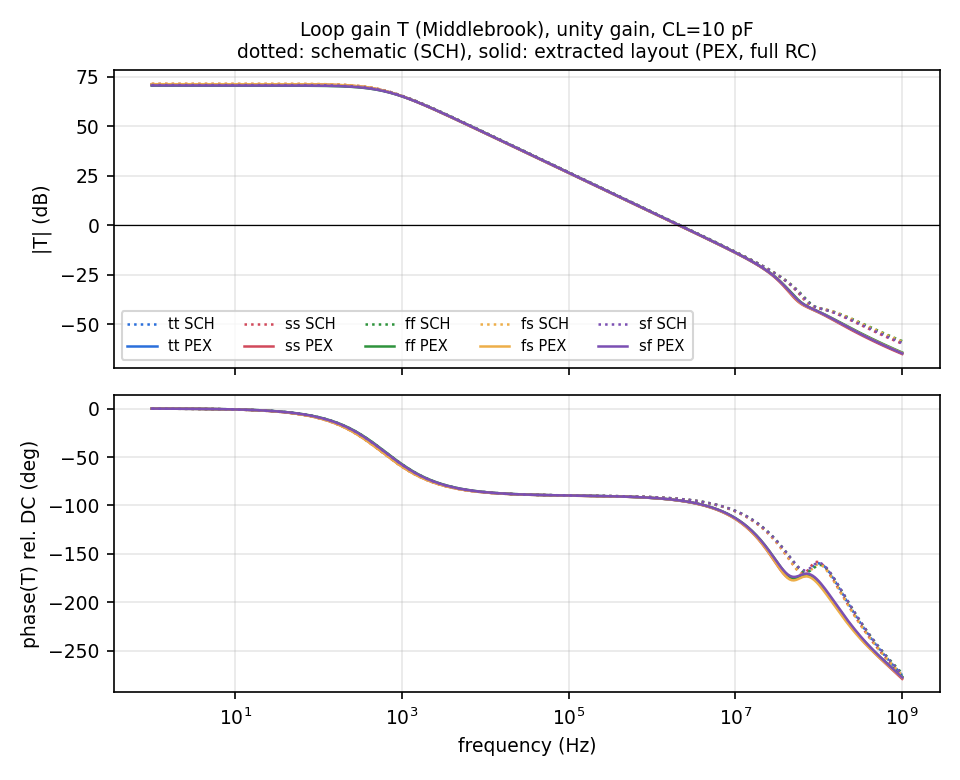

#### 4.2 DC transfer: offset vs input common mode

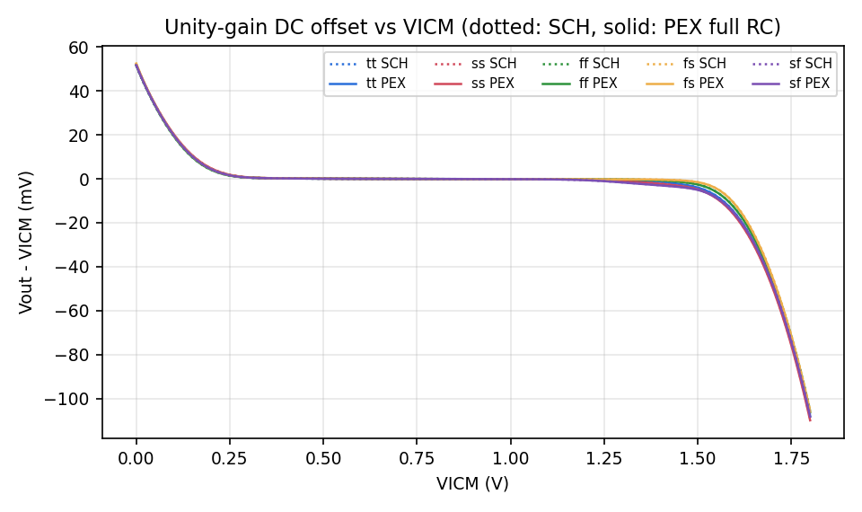

#### 4.3 PSRR

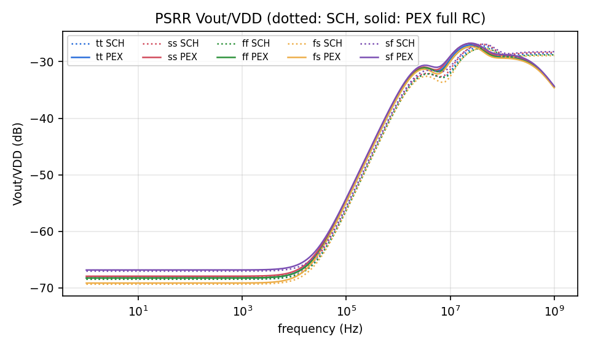

#### 4.4 Transient tracking (dynamic offset)

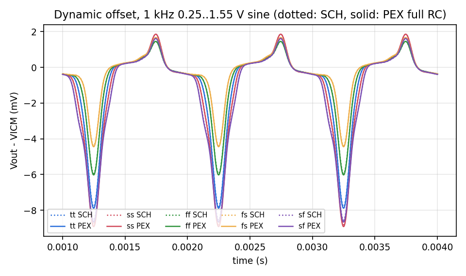

#### 4.5 Monte Carlo offset (mismatch, tt_mm)

| | N | mean (mV) | σ (mV) | ±3σ (mV) | min (mV) | max (mV) |
|---|---|---|---|---|---|---|
| schematic | 200 | -0.253 | 1.625 | ±4.88 | -4.41 | 5.47 |
| layout | 200 | -0.062 | 1.712 | ±5.14 | -5.39 | 4.41 |

With N = 200 the 95 % confidence interval on σ is about ±10 %, so the two σ values are statistically the same. The IP README reports σ = 1.59 mV (N = 1000), which agrees.

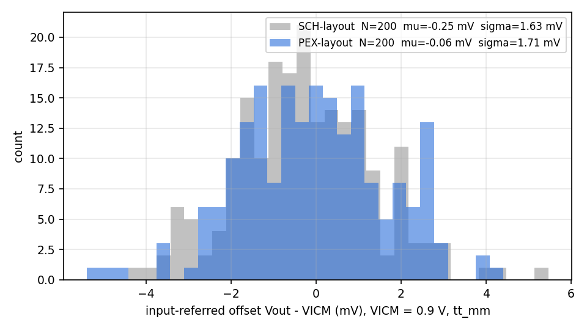

#### 4.6 Start-up

| corner | view | Vout final (V) | MN_TAIL_BIAS final (V) | IDD final, 1.8–2 ms avg (µA) | Vout within 1 mV after (µs) |
|---|---|---|---|---|---|
| tt | schematic | 0.8999 | 0.4800 | 26.01 | 11.7 |
| tt | layout | 0.8999 | 0.4800 | 25.97 | 12.2 |
| ss | schematic | 0.8999 | 0.4951 | 25.53 | 11.8 |
| ss | layout | 0.8999 | 0.4951 | 25.48 | 12.3 |
| ff | schematic | 0.8999 | 0.4649 | 26.49 | 11.4 |
| ff | layout | 0.8999 | 0.4650 | 26.45 | 11.8 |

The supply ramps for 10 µs. In every corner the internal bias starts, Vout settles to within 1 mV about 2 µs after the ramp ends, and the final supply current equals the DC operating point.

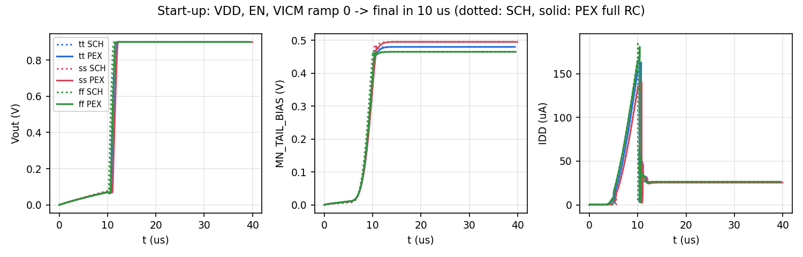

**Start-up mechanism, probed in the extracted layout (tt, nets carry schematic names via layout labels):**

| t (µs) | VDD | VSTRP_IP | net14 | VSTRP_OUT | EN_B | VBP_TOP | MN_TAIL_BIAS | VOUT |
|---|---|---|---|---|---|---|---|---|
| 2 | 0.360 | 0.175 | 0.162 | 0.251 | 0.069 | 0.135 | 0.005 | 0.017 |
| 4 | 0.720 | 0.360 | 0.600 | 0.694 | 0.000 | 0.271 | 0.008 | 0.031 |
| 6 | 1.080 | 0.128 | 1.079 | 0.181 | 0.001 | 0.403 | 0.013 | 0.045 |
| 8 | 1.440 | 0.099 | 1.438 | 0.291 | 0.003 | 0.600 | 0.082 | 0.058 |
| 10 | 1.800 | 0.058 | 1.795 | 0.421 | 0.005 | 1.013 | 0.361 | 0.069 |
| 12 | 1.800 | 1.786 | 0.000 | 1.800 | 0.000 | 0.705 | 0.476 | 0.894 |
| 15 | 1.800 | 1.786 | 0.000 | 1.800 | 0.000 | 0.701 | 0.480 | 0.900 |
| 20 | 1.800 | 1.786 | 0.000 | 1.800 | 0.000 | 0.701 | 0.480 | 0.900 |
| 40 | 1.800 | 1.786 | 0.000 | 1.800 | 0.000 | 0.701 | 0.480 | 0.900 |

While the bias is still off, VSTRP_IP is low and net14 high. VSTRP_OUT is pulled to 0.2–0.4 V, which turns M12 on and injects current from the R24–R34 chain into MN_TAIL_BIAS. Once the beta multiplier is up (~12 µs), M2 lifts VSTRP_IP to 1.79 V, net14 falls, VSTRP_OUT returns to 1.8 V and the injector switches off. Design observation (schematic left unchanged): with EN = 1, M14 (gate EN_B = 0) is always on, so VSTRP_OUT is a ratioed node during start-up (M38/M39 overpower M14). It works in all simulated corners, both pre- and post-layout.

#### 4.7 Post-layout (PEX, full RC) results by themselves

Post-layout netlist only, all five corners. These are the post-layout equivalents of the IP's original `IEEE_plots` (files in `sim/plots/pex/`).

**Loop gain and phase (A0, UGF, PM per corner in the legend)**

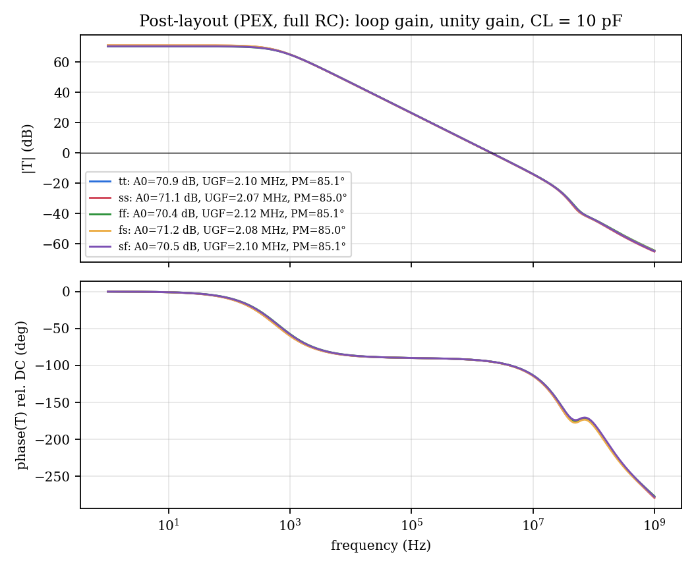

**DC transfer: Vout vs VICM and offset (grey = 0.2–1.6 V window)**

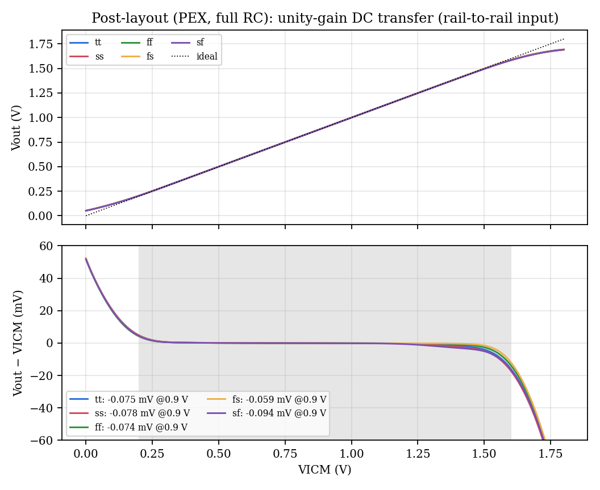

**PSRR**

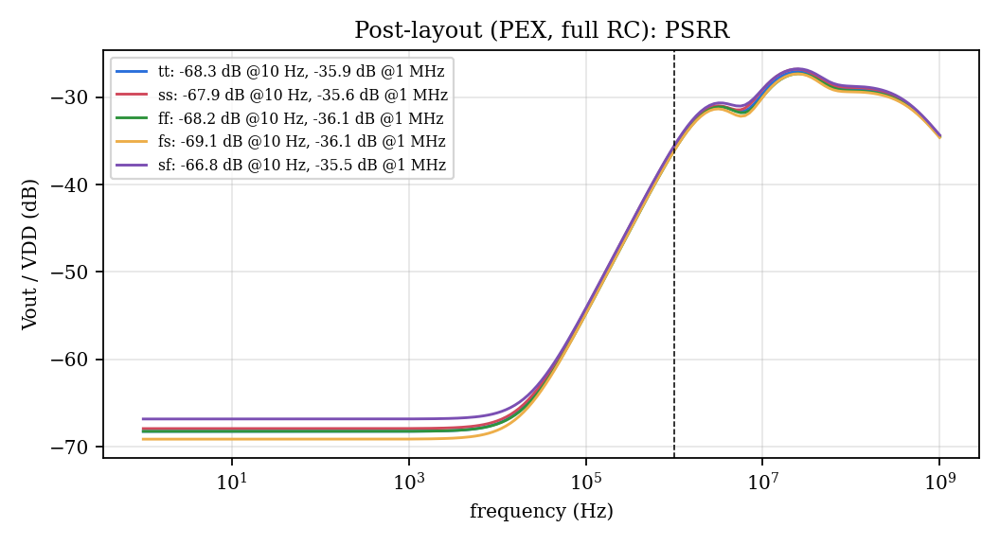

**Unity-gain tracking of a 1 kHz 0.25–1.55 V sine and the dynamic offset**

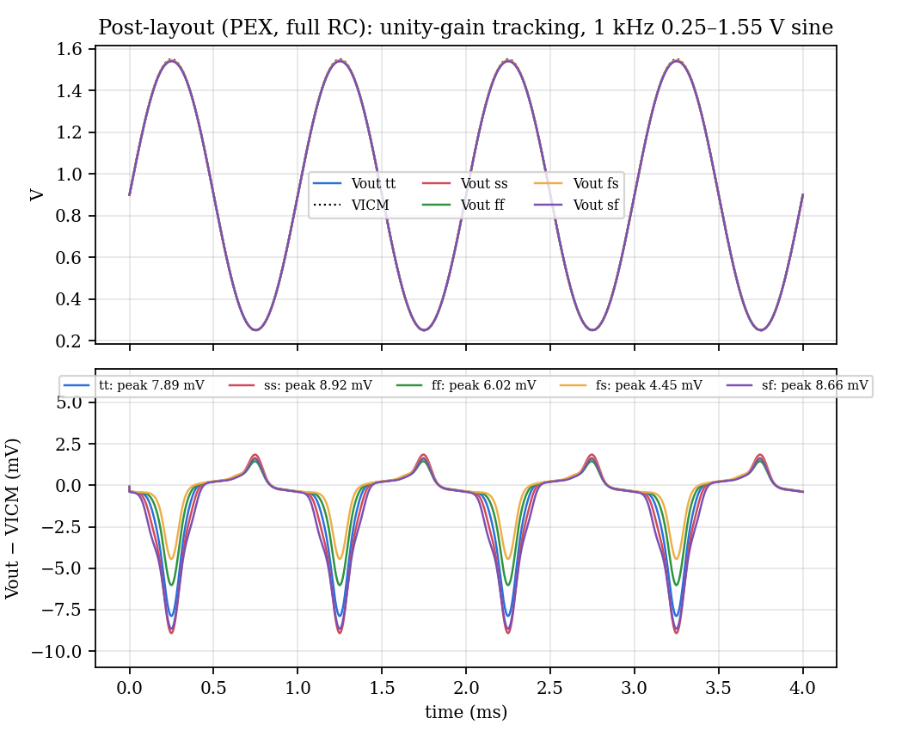

**Mismatch Monte Carlo with Gaussian fit and ±3σ**

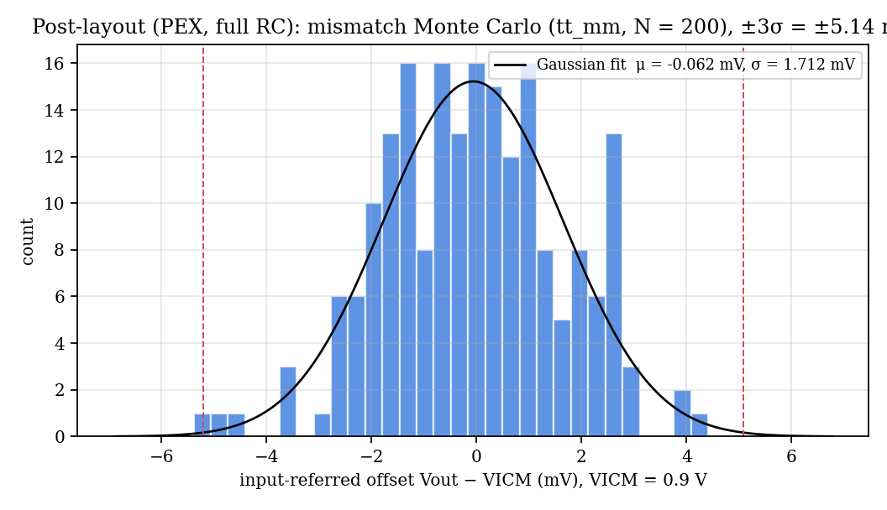

**Start-up**

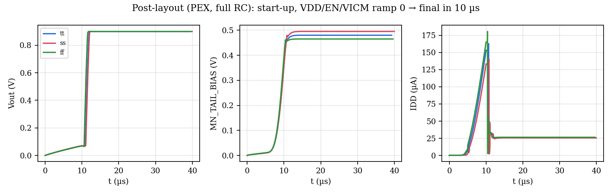

#### 4.8 Power-down (EN = 0) and enable / disable timing

**Method.** The OTA starts enabled (VDD = 1.8 V, VICM = 0.9 V, unity gain, 10 pF). EN is pulled low at 5 µs and the circuit is simulated for 2 ms of power-down (Gear integration). The power-down current is the average supply current over 1.9–2.0 ms, and node states are taken at 2 ms. This mirrors what silicon sees. A plain DC operating point with EN = 0 is ill-conditioned: VOUT and several cascode/start-up nodes float, and in 3 of 16 cases the solver failed to converge and returned non-physical currents, so it is not used.

**Power-down supply current**

| Condition | Schematic (pA) | PEX full RC (pA) |
|---|---|---|
| tt, 27 °C | 15.8 | 16.6 |
| ss, 27 °C | 12.3 | 13.5 |
| ff, 27 °C | 25.3 | 25.7 |
| fs, 27 °C | 10.4 | 11.4 |
| sf, 27 °C | 29.1 | 28.9 |
| tt, −40 °C | 6.2 | 7.4 |
| tt, 85 °C | 369.3 | 292.2 |
| tt, 125 °C | 4430.0 | 2376.4 |

Power-down current is **10–30 pA at 27 °C in every corner**, 0.3–0.4 nA at 85 °C and 2.4–4.4 nA at 125 °C (junction leakage). At 125 °C the layout leaks less than the schematic because the drawn fingers share source/drain diffusions, giving less junction area than the schematic's per-finger AD/AS estimate.

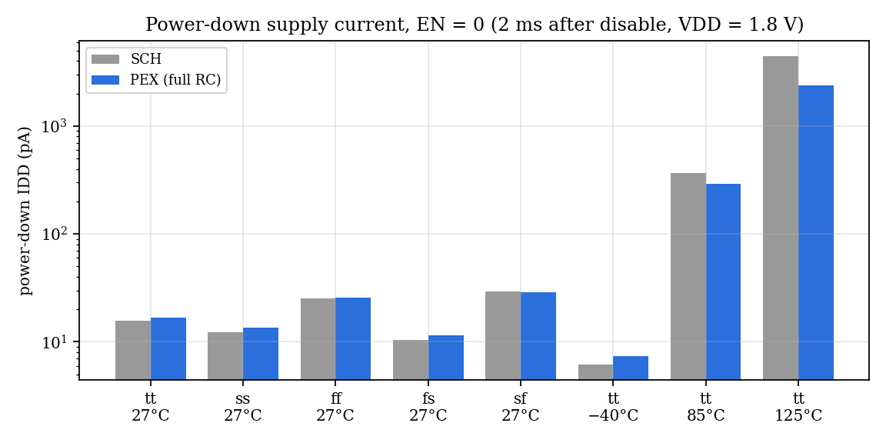

**Node states in power-down (tt, 27 °C, 2 ms after EN → 0)**

| Node | Schematic (V) | PEX (V) | Meaning |
|---|---|---|---|
| MN_TAIL_BIAS | 0.000 | 0.000 | beta-multiplier gate pulled to GNDA by XM16 |
| VBP_TOP | 1.800 | 1.800 | PMOS bias rail pulled to VDD by M15 |
| net8 | 0.000 | 0.000 | NMOS mirror gate pulled to GNDA by MN_SW1 |
| net9 | 1.800 | 1.800 | PMOS tail gate pulled to VDD by MP_SW1 |
| VBP_CASC | 1.800 | 1.800 | PMOS cascode gate pulled to VDD by MP_SW2 |
| VBN_CASC | 0.000 | 0.000 | NMOS cascode gate pulled to GNDA by MN_SW2 |
| VSTRP_IP | 0.000 | 0.000 | start-up sense node low (bias off) |
| net14 | 1.800 | 1.800 | inverter output high |
| VSTRP_OUT | 1.799 | 1.799 | M12 gate ≈ VDD: start-up injector off (only weakly held; see sf) |
| net15 | 1.800 | 1.800 | = VDD, so no current flows through R24–R34 |
| EN_B | 1.800 | 1.800 | inverted enable |
| VOUT | 0.902 | 0.902 | floats and holds its last value on CL (high impedance in power-down) |

VSTRP_OUT is not actively driven in power-down (M13, M14 and M39 are off). It settles at 1.66 V in sf and 1.71 V at −40 °C (PEX), which keeps M12 off in every simulated case; the power-down current confirms no leakage through the resistor chain.

**Enable / disable timing** (EN 0→1 at 20 µs, 1→0 at 120 µs)

| corner | view | IDD enabled (µA) | bias within 1 % (µs) | IDD within 2 % (µs) | Vout within 1 mV (µs) | IDD < 1 % after EN↓ (µs) | IDD 100 µs after EN↓ (nA) |
|---|---|---|---|---|---|---|---|
| tt | schematic | 26.01 | 2.45 | 3.28 | 3.33 | 0.38 | 0.023 |
| tt | PEX | 25.97 | 3.04 | 4.06 | 4.15 | 0.42 | 0.031 |
| ss | schematic | 25.53 | 2.61 | 3.42 | 3.47 | 0.37 | 0.020 |
| ss | PEX | 25.48 | 3.22 | 4.60 | 4.70 | 0.42 | 0.027 |
| ff | schematic | 26.49 | 2.44 | 3.13 | 3.03 | 0.36 | 0.032 |
| ff | PEX | 26.45 | 2.71 | 3.73 | 3.78 | 0.39 | 0.038 |

Wake-up to full accuracy takes 3.0–4.7 µs. The extracted layout is 0.6–1.2 µs slower than the schematic because of the extra parasitic capacitance on the bias rails. Shut-down drops the current below 1 % within 0.4 µs; the remaining tail settles to the pA leakage floor over ~100 µs.

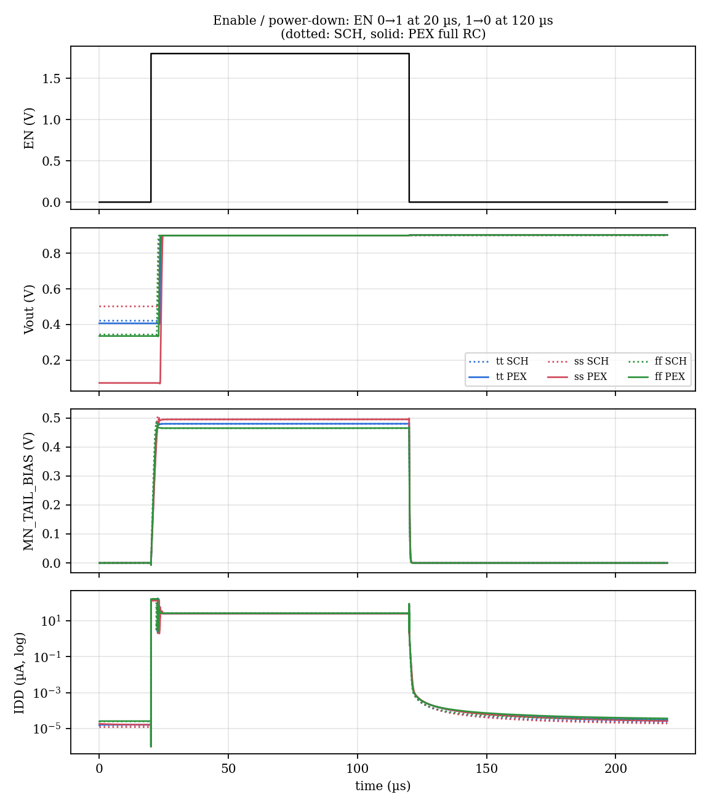

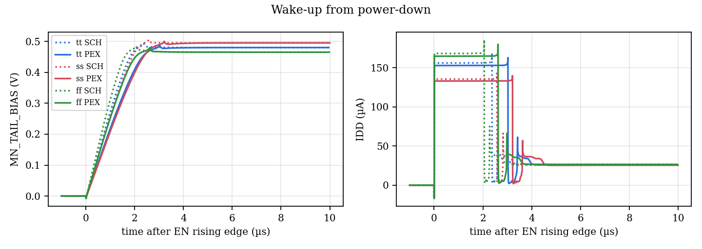

### 5. Layout vs PEX: where the deltas come from

The same testbenches were run on five netlist views. Each step adds exactly one effect:

| View | Netlist | Adds |
|---|---|---|
| Schematic | `sim/dut_sch.spice` | — (schematic devices, `m=` multipliers, xschem AD/AS) |
| Layout, devices only | `mag/Rail_to_Rail_IP_OP_OTA_with_Intrenal_Bias.lvs.spice` (`ext2spice lvs`) | **device geometry**: the 225 drawn fingers with real AD/AS/PD/PS, no wiring |
| PEX C-only | `pex/Rail_to_Rail_IP_OP_OTA_with_Intrenal_Bias_cx.spice` | **wiring capacitance** (substrate + coupling), magic's standard extraction: best estimate |
| PEX RC, all R shorted | `pex/Rail_to_Rail_IP_OP_OTA_with_Intrenal_Bias_rcx_R0.spice` | the **extra substrate capacitance** that magic's `extresist` writes on the resistor sub-nodes (no resistance) |
| PEX full RC | `pex/Rail_to_Rail_IP_OP_OTA_with_Intrenal_Bias_rcx.spice` | **wiring resistance** |

**Why two capacitance levels.** The coupling capacitors are identical in both extractions. `extresist`, however, writes additional substrate capacitance on every resistor sub-node, while the lumped node capacitance stays in the netlist. Total extracted capacitance rises from 0.68 pF (C-only) to 1.43 pF (RC), about 1.9–2× on every signal net. For VOUT, for example, the substrate capacitance goes from 1.5 fF to ≈ 9.7 fF, while a hand estimate of its ≈ 40 µm met3 bus and ≈ 50 µm of met2 tracks gives a few fF. The C-only value is therefore the best estimate, and the RC netlist is a conservative bound.

**tt, 27 °C, step by step**

| Parameter | Schematic | Layout (devices) | PEX C-only | PEX RC, R shorted | PEX full RC | Δ geometry | Δ wiring C | Δ extresist extra C | Δ wiring R |
|---|---|---|---|---|---|---|---|---|---|
| DC loop gain (dB) | 71.12 | 70.95 | 70.95 | 70.95 | 70.90 | -0.17 | -0.00 | +0.00 | -0.05 |
| Unity-gain frequency (MHz) | 2.147 | 2.144 | 2.121 | 2.103 | 2.099 | -0.003 | -0.022 | -0.018 | -0.004 |
| Phase margin (deg) | 86.64 | 86.83 | 85.83 | 85.07 | 85.07 | +0.19 | -1.00 | -0.75 | -0.00 |
| Systematic offset @ VICM=0.9 V (mV) | -0.075 | -0.076 | -0.076 | -0.076 | -0.075 | -0.001 | +0.000 | +0.000 | +0.001 |
| Worst-case offset, VICM 0.2–1.6 V (mV) | 15.64 | 15.39 | 15.39 | 15.39 | 15.80 | -0.25 | +0.00 | -0.00 | +0.41 |
| PSRR @ 10 Hz (Vout/VDD) (dB) | -68.45 | -68.29 | -68.29 | -68.29 | -68.25 | +0.16 | +0.00 | +0.00 | +0.04 |
| PSRR @ 1 MHz (Vout/VDD) (dB) | -37.36 | -37.31 | -36.40 | -35.88 | -35.87 | +0.06 | +0.91 | +0.52 | +0.01 |
| Peak dynamic offset (1 kHz sine) (mV) | 7.788 | 7.684 | 7.685 | 7.685 | 7.887 | -0.104 | +0.000 | +0.000 | +0.202 |
| Supply current (uA) | 26.013 | 26.002 | 26.002 | 26.002 | 25.970 | -0.011 | +0.000 | +0.000 | -0.032 |
| MN_TAIL_BIAS voltage (V) | 0.4800 | 0.4800 | 0.4800 | 0.4800 | 0.4800 | -0.0000 | +0.0000 | +0.0000 | +0.0001 |

**DC loop gain (dB), all corners**

| view | tt | ss | ff | fs | sf |
|---|---|---|---|---|---|
| Schematic | 71.12 | 71.31 | 70.68 | 71.37 | 70.76 |
| Layout, devices only | 70.95 | 71.16 | 70.49 | 71.21 | 70.58 |
| PEX C-only | 70.95 | 71.16 | 70.49 | 71.21 | 70.58 |
| PEX RC, all R shorted | 70.95 | 71.16 | 70.49 | 71.21 | 70.58 |
| PEX full RC | 70.90 | 71.10 | 70.43 | 71.15 | 70.53 |

**Unity-gain frequency (MHz), all corners**

| view | tt | ss | ff | fs | sf |
|---|---|---|---|---|---|
| Schematic | 2.147 | 2.120 | 2.167 | 2.131 | 2.151 |
| Layout, devices only | 2.144 | 2.117 | 2.163 | 2.128 | 2.148 |
| PEX C-only | 2.121 | 2.095 | 2.141 | 2.106 | 2.125 |
| PEX RC, all R shorted | 2.103 | 2.077 | 2.122 | 2.087 | 2.107 |
| PEX full RC | 2.099 | 2.073 | 2.118 | 2.084 | 2.103 |

**Phase margin (deg), all corners**

| view | tt | ss | ff | fs | sf |
|---|---|---|---|---|---|
| Schematic | 86.64 | 86.62 | 86.67 | 86.63 | 86.66 |
| Layout, devices only | 86.83 | 86.83 | 86.84 | 86.82 | 86.85 |
| PEX C-only | 85.83 | 85.80 | 85.86 | 85.81 | 85.88 |
| PEX RC, all R shorted | 85.07 | 85.03 | 85.13 | 85.04 | 85.14 |
| PEX full RC | 85.07 | 85.03 | 85.13 | 85.04 | 85.14 |

**PSRR @ 1 MHz (Vout/VDD) (dB), all corners**

| view | tt | ss | ff | fs | sf |
|---|---|---|---|---|---|
| Schematic | -37.36 | -37.08 | -37.60 | -37.66 | -36.95 |
| Layout, devices only | -37.31 | -37.01 | -37.56 | -37.59 | -36.91 |
| PEX C-only | -36.40 | -36.12 | -36.64 | -36.65 | -36.04 |
| PEX RC, all R shorted | -35.88 | -35.62 | -36.09 | -36.10 | -35.55 |
| PEX full RC | -35.87 | -35.61 | -36.08 | -36.09 | -35.54 |

**Supply current (uA), all corners**

| view | tt | ss | ff | fs | sf |
|---|---|---|---|---|---|
| Schematic | 26.013 | 25.526 | 26.493 | 25.894 | 26.131 |
| Layout, devices only | 26.002 | 25.515 | 26.483 | 25.883 | 26.121 |
| PEX C-only | 26.002 | 25.515 | 26.483 | 25.883 | 26.121 |
| PEX RC, all R shorted | 26.002 | 25.515 | 26.483 | 25.883 | 26.121 |
| PEX full RC | 25.970 | 25.484 | 26.449 | 25.852 | 26.087 |

**Interpretation (tt):**

* **Device geometry** (real fingers and shared diffusions) changes PM by +0.19°, UGF by -3.2 kHz and the DC loop gain by -0.17 dB.
* **Wiring capacitance** (best estimate) changes PM by -1.00°, UGF by -22.5 kHz and PSRR @ 1 MHz by +0.91 dB.
* The **extra substrate capacitance from `extresist`** adds -0.75° PM, -18.3 kHz UGF and +0.52 dB PSRR @ 1 MHz on top. This is the pessimism of the RC netlist.
* **Wiring resistance** is negligible: -0.005° PM and -3.7 kHz UGF.

**Per-net check of wiring resistance (tt):** each net's extracted resistors were shorted one at a time in the full-RC netlist and the loop gain re-simulated (`sim/r_attribution.py`). The largest single-net effects are:

| Net whose R is shorted | Σ R in net (Ω) | Δ UGF (kHz) | Δ PM (deg) |
|---|---|---|---|
| GNDA | 252315 | +0.33 | -0.0076 |
| VINN | 8002 | +0.00 | +0.0045 |
| net2 | 2764 | +0.68 | +0.0032 |
| net4 | 4701 | +1.19 | +0.0029 |
| net3 | 4811 | -0.45 | +0.0022 |
| VDD | 72233 | -0.56 | -0.0022 |
| net5 | 6626 | -0.04 | +0.0020 |
| VINP | 8948 | -0.00 | +0.0011 |

All nets shorted together: PM 85.072° vs 85.067° with resistance. No net's wiring resistance matters for stability in this layout.

**Loop gain, tt: all views (right: zoom on the high-frequency region where parasitics act)**

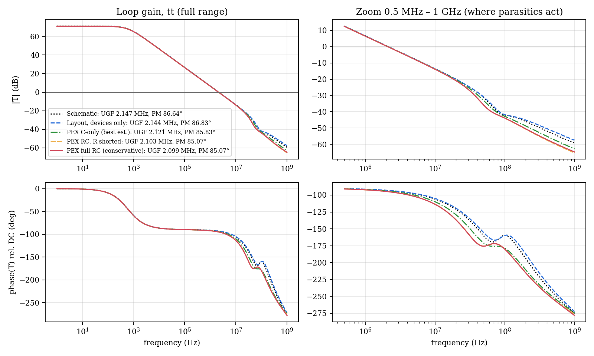

**Key metrics per corner for all views**

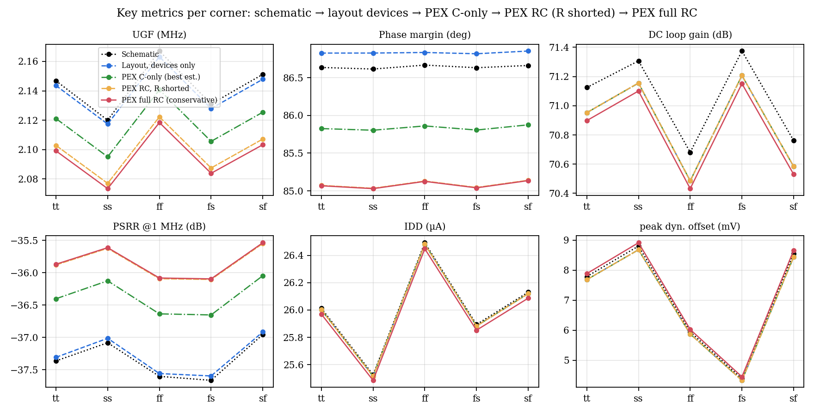

**PSRR, tt: all views**

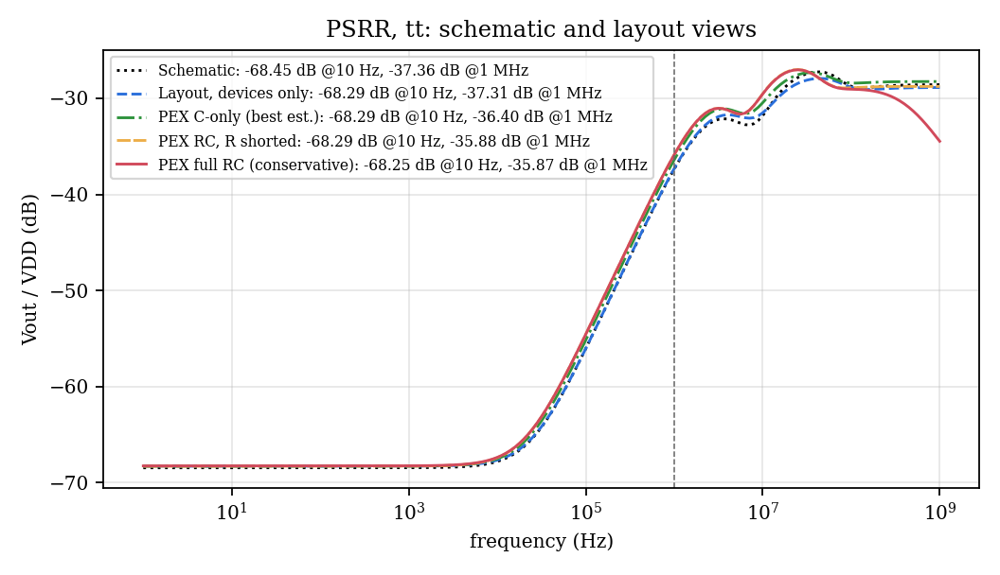

**DC offset, tt, and the difference of each layout view to the schematic (µV)**

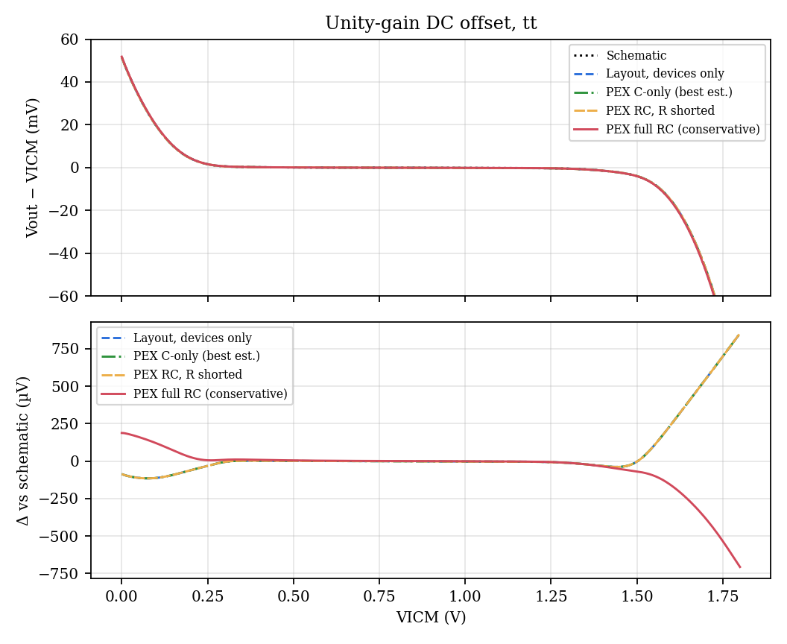

**Dynamic offset, tt, and the difference to the schematic (µV)**

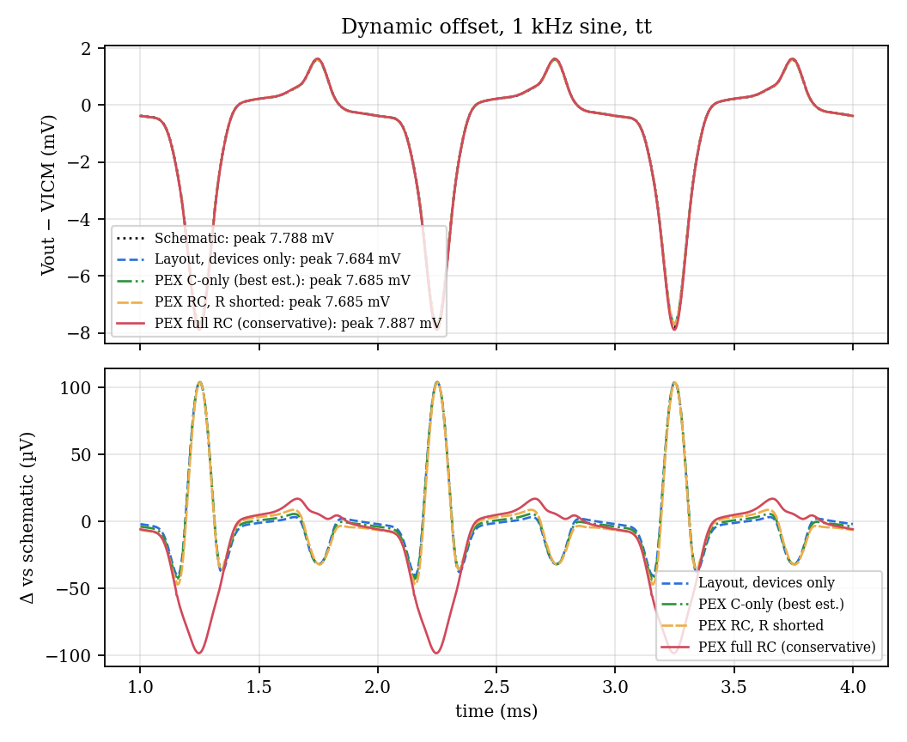

#### 5.1 met1 shunt of the input gate straps: before → after

The first layout routed the input-pair gates on li1 only (≈ 12.8 Ω/sq): a strap along each row and a vertical li bar per input. That gave a mean pin-to-gate resistance of 1.1–1.4 kΩ (up to 3 kΩ), and VINP and VINN were noticeably asymmetric. The final layout shunts every input gate strap (PMOS pair S0–S4, NMOS pair S0–S2) and both vertical bars with met1, with an mcon at every gate. To keep magic's 0.28 µm spacing from the long S/D stripes, the merged PMOS strap gap grew from 0.64 to 0.80 µm and the NMOS one from 0.78 to 0.80 µm (+0.18 µm cell height). The top and bottom strips of the two input guard rings became li-only taps (no DC current; the vertical ring strips keep met1).

**Effective resistance from the input pin to the 36 input-pair gate fingers** (solved on the extracted RC network, `sim/gate_resistance.py`)

| Net | Before: mean / max (Ω) | After: mean / max (Ω) | Reduction of mean |
|---|---|---|---|
| VINP | 1435 / 3016 | 111 / 124 | 92 % |
| VINN | 1090 / 1670 | 111 / 123 | 90 % |

**Effect on stability.** Shorting all wiring resistance in the old RC netlist raised PM by only +0.104°. After the shunt the same test gives +0.005°. The shunt therefore removed essentially all of the (small) resistive effect, and PM improved by the expected ≈ 0.1°. Stability was never resistance-limited: VINP is driven from outside the feedback loop, and VINN's gate capacitance is largely bootstrapped by the pair's common source. The practical benefits of the shunt are **symmetric, low-resistance inputs** (≈ 110 Ω) and less gate-resistance thermal noise (√(4kTR): 4.9 → 1.4 nV/√Hz on VINP).

| Metric | Corner | Schematic | PEX RC before | PEX RC after | Change |
|---|---|---|---|---|---|
| UGF (MHz) | tt | 2.147 | 2.104 | 2.099 | -0.005 |
| UGF (MHz) | ss | 2.120 | 2.078 | 2.073 | -0.005 |
| UGF (MHz) | ff | 2.167 | 2.123 | 2.118 | -0.005 |
| UGF (MHz) | fs | 2.131 | 2.089 | 2.084 | -0.005 |
| UGF (MHz) | sf | 2.151 | 2.108 | 2.103 | -0.005 |
| Phase margin (deg) | tt | 86.64 | 84.98 | 85.07 | +0.090 |
| Phase margin (deg) | ss | 86.62 | 84.94 | 85.03 | +0.089 |
| Phase margin (deg) | ff | 86.67 | 85.03 | 85.13 | +0.092 |
| Phase margin (deg) | fs | 86.63 | 84.95 | 85.04 | +0.090 |
| Phase margin (deg) | sf | 86.66 | 85.05 | 85.14 | +0.090 |
| PSRR @ 1 MHz (dB) | tt | -37.36 | -35.90 | -35.87 | +0.035 |
| PSRR @ 1 MHz (dB) | ss | -37.08 | -35.65 | -35.61 | +0.035 |
| PSRR @ 1 MHz (dB) | ff | -37.60 | -36.12 | -36.08 | +0.036 |
| PSRR @ 1 MHz (dB) | fs | -37.66 | -36.13 | -36.09 | +0.037 |
| PSRR @ 1 MHz (dB) | sf | -36.95 | -35.57 | -35.54 | +0.034 |
| DC loop gain (dB) | tt | 71.12 | 70.90 | 70.90 | +0.000 |
| DC loop gain (dB) | ss | 71.31 | 71.10 | 71.10 | +0.000 |
| DC loop gain (dB) | ff | 70.68 | 70.43 | 70.43 | +0.000 |
| DC loop gain (dB) | fs | 71.37 | 71.15 | 71.15 | +0.000 |
| DC loop gain (dB) | sf | 70.76 | 70.53 | 70.53 | +0.000 |

MC offset σ (PEX): 1.562 mV before, 1.712 mV after. Offsets, supply current and start-up are unaffected by the change.

### 6. Parasitics of the critical nets

Total extracted capacitance per net from the **PEX C-only** (best-estimate) extraction, summing capacitance to substrate and coupling to all other nets. Internal nets carry the schematic names via layout labels. The R-segment count is from the full-RC extraction.

| Net | Role | C_total (fF) | extracted R segments |
|---|---|---|---|
| VINP | input + | 80.35 | 119 |
| VINN | input − | 79.52 | 137 |
| net1 | PMOS-pair drain A / NMOS fold | 52.32 | 73 |
| net2 | PMOS-pair drain B / NMOS fold | 54.81 | 73 |
| net3 | NMOS-pair drain A / PMOS fold | 19.56 | 43 |
| net4 | NMOS-pair drain B / PMOS fold | 18.15 | 42 |
| net5 | high-Z node L1 (mirror gate) | 30.39 | 47 |
| VOUT | output | 16.44 | 21 |
| net6 | NMOS-pair tail | 24.42 | 47 |
| net7 | PMOS-pair tail | 67.84 | 127 |
| MN_TAIL_BIAS | bias node / pin | 69.00 | 55 |
| EN | enable | 12.99 | 13 |

**Symmetry of matched nets**

| Pair | C (fF) | C (fF) | mismatch |
|---|---|---|---|
| VINP / VINN | 80.35 | 79.52 | -1.0 % |
| net1 / net2 | 52.32 | 54.81 | +4.6 % |
| net3 / net4 | 19.56 | 18.15 | -7.5 % |

The input nets match to under 1 %. The folding nodes differ by 1.5–2.7 fF because the net1/net3 buses run on the left of the core and net2/net4 on the right with different lengths. These are non-dominant, low-impedance nodes (1/gm of the cascodes), so the imbalance does not show up in the offset (the systematic offset is unchanged to 1 µV, §3).

### 7. Discussion

* **Stability / bandwidth.** Against the schematic, the best-estimate extraction (C-only) changes UGF by -1.2 % and PM by -0.81°. The conservative RC netlist changes them by -2.2 % and -1.57°, the same in every corner. Almost all of it is parasitic capacitance at the folding nodes (net1–net5) acting on the non-dominant poles. Wiring resistance contributes -0.005° (§5). With the 10 pF load the OTA stays over-damped (PM ≈ 85–86°).
* **DC accuracy.** Systematic offset is unchanged (≤ 1 µV difference). The DC loop gain changes by -0.23 dB. IR drops in the routing are negligible at this 26 µA supply current, consistent with VOUT and MN_TAIL_BIAS matching to 0.1 mV.
* **PSRR.** Low-frequency PSRR is unchanged within 0.2 dB. At 1 MHz it degrades by +0.96 dB (C-only) to +1.49 dB (RC), through coupling capacitance between the VDD rails/n-ring and internal nodes. It remains ≈ -36 dB.
* **Matching.** Mismatch σ is preserved (layout and schematic are statistically identical). SPICE Monte Carlo models only random mismatch. The common-centroid placement (§8) additionally cancels linear process gradients, which neither simulation captures; this is a layout-only benefit.
* **Power and start-up.** IDD differs by < 0.2 %. Start-up is clean in ss/tt/ff and identical to the schematic within 0.4 µs.

### 8. Matching / floorplan decisions

| Group | Arrangement |
|---|---|
| MP_A1/MP_A2 (pfet_lvt, 28+28 × W4/L2) | 4×14, rows X X̄ X̄ X (X = ABBAABBAABBAAB): common centroid in x and y and cancels the xy cross-term; edge fingers balanced (A at the ends of rows 1/4, B of rows 2/3); n-tap guard ring |
| MN_A1/MN_A2 (nfet_lvt, 8+8 × W2.5/L2) | 2×8 ABBAABBA / BAABBAAB, 2-D common centroid; p-tap guard ring |
| MP_TOP_L1/L2 (6+6) | ABBA·ABBA·ABBA, continuous diffusion |
| MN_BOT_L1/L2 (6+6), MN_NDIFF_BIAS (8) | 2 rows ABBAAB / BAABBA (2-D CC), NDIFF_BIAS split symmetrically 2+2 per row |
| MP_CASC_L1/L2 (8+8) | [A4][B4][B4][A4] |
| MN_CASC_L1/L2 (3+3) | [A1][B2][A2][B1] (closest to centroid possible with 3+3) |
| net9 mirror | MP_PDIFF_BIAS 4 + 4 symmetric about the diode MP_PDIFF_BIAS_B |
| VBP_TOP mirror | M3 (diode) and M4 adjacent with shared source; M9, M2 same row and orientation |
| XM1/XM10 (16+4 × W10/L4) | 2 identical rows [M1×4][M10×2][M1×4]: 2-D common centroid, merged gate strap |

Per-finger W and L are the schematic's, and netgen merges parallel fingers, so sizes match exactly. Dummy transistors were **not** added: they would appear as extra devices in LVS against the unmodified schematic. Edge effects are handled by the common-centroid patterns instead.

### 9. Notes for integration

* LVS reference: the schematic ties NMOS bodies to the global `GND` net. In silicon the p-substrate is `GNDA` (all p-taps), so `lvs/run_lvs.sh` maps body `GND` → `GNDA`. Nothing else is altered.
* Pins (port order = symbol order): VDD (met1, top rail), EN (met2, right edge), VINN (met3, top), VOUT (met3, bottom), VINP (met3, left), MN_TAIL_BIAS (met3, bottom), GNDA (met1, bottom rail). met4/met5 are unused and free for top-level routing.
* Reproduce everything with `./run_all.sh` (layout generation → magic DRC → KLayout DRC → LVS → PEX → all simulations). Then `python3 sim/run_views.py && python3 sim/plot_results.py && python3 sim/plot_pex.py && python3 sim/plot_views.py && python3 sim/parasitics.py && python3 sim/startup_probe.py && python3 sim/make_report.py`.
* Post-layout netlists for top-level simulation: `pex/Rail_to_Rail_IP_OP_OTA_with_Intrenal_Bias_cx.spice` (C-only, best estimate) or `pex/Rail_to_Rail_IP_OP_OTA_with_Intrenal_Bias_rcx.spice` (full RC, conservative, with extra substrate C from `extresist`). Both have the same port order as the symbol.
* Simulation note: the start-up supply current must be read with Gear integration (or averaged). Trapezoidal integration rings point-to-point on the source current; the ringing averages to the DC value.
<!-- END:LAYOUT-VERIFICATION -->

---

## File Structure

```
RR_Inp_SE_OTA_IntBias/
├── SCH/
│   ├── Rail_to_Rail_IP_OP_OTA_with_Intrenal_Bias.sch  # Top-level OTA schematic (Xschem)
│   ├── Rail_to_Rail_IP_OP_OTA_with_Intrenal_Bias.sym  # Xschem symbol
│   ├── Rail_to_Rail_IP_OP_OTA_with_Intrenal_Bias.pdf  # Schematic screenshot
│   ├── tb_Rail_to_Rail_IP_OP_OTA_int_bias.sch
│   ├── tb_Rail_to_Rail_IP_OP_OTA_int_bias_STB.sch     # Stability testbench schematic
│   ├── tb_Rail_to_Rail_IP_OP_OTA_int_bias_MC.sch      # Monte Carlo testbench schematic
│   └── tb_Rail_to_Rail_IP_OP_OTA_int_bias_DC_TRAN_PSRR.sch # DC/Transient/PSRR testbench
├── Rail_to_Rail_IP_OP_OTA_int_bias_Sims/
│   ├── IEEE_plots/
│   │   ├── dc_ieee.png / .pdf                         # DC transfer characteristic
│   │   ├── stb_ieee.png / .pdf                        # Loop gain & phase
│   │   ├── tran_ieee.png / .pdf                       # Transient response
│   │   ├── psrr_ieee.png / .pdf                       # PSRR
│   │   └── mc_ieee.png / .pdf                         # Monte Carlo offset histogram
│   ├── DC/
│   │   ├── csv_results/                               # Per-corner DC CSV data
│   │   ├── spice/                                     # Per-corner DC netlists & logs
│   │   └── DC_cross_corner.html                       # Interactive Plotly DC plot
│   ├── STB/
│   │   ├── csv_results/                               # Per-corner STB CSV data
│   │   ├── spice/                                     # Per-corner STB netlists & logs
│   │   └── STB_cross_corner.html                      # Interactive Plotly STB plot
│   ├── TRAN/
│   │   ├── csv_results/                               # Per-corner transient CSV data
│   │   ├── spice/                                     # Per-corner transient netlists & logs
│   │   └── TRAN_cross_corner.html                     # Interactive Plotly transient plot
│   ├── PSRR/
│   │   ├── csv_results/                               # Per-corner PSRR CSV data
│   │   ├── spice/                                     # Per-corner PSRR netlists & logs
│   │   └── PSRR_cross_corner.html                     # Interactive Plotly PSRR plot
│   └── MC/
│       ├── csv_results/                               # MC offset CSV data
│       ├── spice/                                     # MC netlist & raw output
│       └── MC_offset_histogram.html                   # Interactive Plotly MC histogram
├── LAYOUT/                                            # DRC/LVS-clean layout, PEX, post-layout verification
│   ├── gds/  mag/  pex/  lvs/  drc/                   # GDS, magic layout, RC netlist, LVS/DRC reports
│   ├── sim/  docs/                                    # schematic-vs-layout sims, plots, report
│   └── README.md                                      # layout + verification documentation
├── different_spice/                                   # Standalone SPICE netlists
│   ├── Rail_to_Rail_IP_OP_OTA_with_Intrenal_Bias.spice
│   ├── tb_Rail_to_Rail_IP_OP_OTA_int_bias.spice
│   ├── tb_Rail_to_Rail_IP_OP_OTA_int_bias_STB.spice
│   ├── tb_Rail_to_Rail_IP_OP_OTA_int_bias_MC.spice
│   └── tb_Rail_to_Rail_IP_OP_OTA_int_bias_DC_TRAN_PSRR.spice
├── cross_corner_sim_Rail_to_Rail_OTA.py               # Python cross-corner automation script
├── device_db.json
├── sky130_area_estimator.py
└── README.md
```

---

> Designed using open-source EDA: [Xschem](https://xschem.sourceforge.io/) · [Ngspice](https://ngspice.sourceforge.io/) · [Magic VLSI](http://opencircuitdesign.com/magic/) · [SKY130 PDK](https://github.com/google/skywater-pdk)
